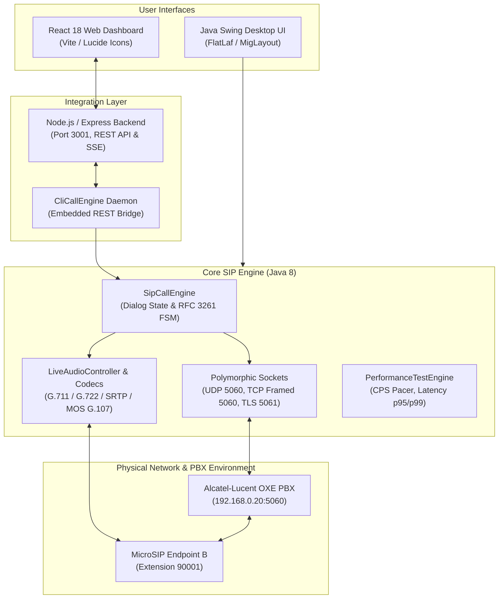

# SIP Simulator v4

A high-performance SIP (Session Initiation Protocol) simulation, automated testing, audio qualification, and diagnostic platform designed for telecom engineers, VoIP developers, and PBX administrators.

SIP Simulator v4 combines a robust **Java 8 Desktop Client** (Swing, FlatLaf, MigLayout) for local protocol simulation and packet crafting with a synchronized **React 18 + Vite Web Dashboard** and **Express REST Daemon** for multi-call orchestration, live ladder trace analysis, and remote telephony management.

---

## 1. Project Overview

SIP Simulator v4 provides enterprise-grade SIP endpoint and PBX load testing capabilities. It is engineered to simulate realistic VoIP calling scenarios, measure real-time media quality, validate RFC protocol compliance, and qualify live PBX deployments under controlled conditions.

The platform has been validated end-to-end against physical enterprise telephony equipment—specifically the **Alcatel-Lucent OmniPCX Enterprise (OXE R101.1 n4.524.2)** PBX and RFC-compliant endpoints (**MicroSIP 3.22.16**).

---

## 2. Features

- **Full SIP Dialog Lifecycle Management:**
  Stateful dialog tracking (`IDLE`, `CALLING`, `PROCEEDING`, `RINGING`, `EARLY_MEDIA`, `ESTABLISHED`, `TERMINATING`, `TERMINATED`, `FAILED`) with RFC 3261 Timer A exponential retransmission and Timer B timeout handling.
- **Mid-Dialog RFC Compliance (RFC 3261 §14.1 & RFC 6086 §4.2.2):**
  Mid-dialog request rejections (e.g., 488 for INFO or Re-INVITE) fail only the sub-transaction and preserve the established call dialog without tearing down media or terminating the session.
- **Telecom Audio & Codec Negotiation:**
  Supports G.711 A-law (PCMA, PT=8), G.711 $\mu$-law (PCMU, PT=0), and wideband G.722 (PT=9). Features dual WAV audio recording (`tx_<callId>.wav` & `rx_<callId>.wav`) with peak amplitude and RMS analysis.
- **SRTP Cryptographic Security:**
  AES-CM-128 encryption with HMAC-SHA1-80 authentication via RFC 4568 SDES negotiation.
- **In-Band & Out-of-Band DTMF:**
  RTP telephone-events (RFC 2833 / RFC 4733) with dynamic payload type negotiation (supporting PT 101, PT 120 on OXE, and dynamic PTs), redundant end packets ($E=1$), and SIP INFO (`application/dtmf-relay`).
- **Call Transfer & Supplementary Services:**
  Blind transfer via SIP `REFER` (RFC 3515) and attended transfer with escaped `Replaces` headers (RFC 3891). Call Hold (`a=sendonly`) and Resume (`a=sendrecv`) via Re-INVITE with independent local and remote hold arbitration.
- **Early Media & Identity Headers:**
  Provisional 183 Session Progress with SDP media validation (port > 0 and unicast IP verification) and background audio streaming. Automated parsing of `P-Asserted-Identity`, `Remote-Party-ID`, `Diversion`, `Privacy`, and caller display names.
- **Real-Time ITU-T E-Model G.107 MOS Calculation:**
  Computes transmission rating factor $R$ and Mean Opinion Score ($1.0 \le \text{MOS} \le 4.5$) taking into account packet loss concealment (PLC, $B_{pl}=19.0$), mouth-to-ear delay ($10\text{ms} + 20\text{ms} + 2 \times \text{jitter}$), and packet loss.
- **Multi-Call Orchestration & Performance Engine:**
  Supports Single-call, Sequential, Concurrent, CPS rate-controlled, and Soak testing modes with setup latency percentiles ($p50, p95, p99$) and automated HTML/JSON report generation.
- **Visual Signaling Ladder Diagram:**
  Interactive SVG/HTML message flow sequence diagram with color-coded message arrows, CSeq identifiers, and instant detail inspection.
- **Evidence-Based Campaign Failure Intelligence:**
  Automated root-cause triage classifying failures into `PBX_REJECTION`, `PROTOCOL_ERROR`, `MEDIA_FAILURE`, `TIMEOUT`, `CONFIG_ERROR`, and `NETWORK_UNREACHABLE` with failure stage detection, certainty rating, and suggested investigation steps.
- **Unified Network & Protocol Testing:**
  Full impairment injection (latency delay, packet loss, jitter) affecting both SIP signaling and RTP media streams, malformed SIP header injection (`CSeq`, `Call-ID`, `Via`, `Expires`, `Content-Length`, `Max-Forwards`), live observability monitor, and comparative baseline/impaired/recovery test runs with CSV export.
- **RTP Inspector & Media Telemetry:**
  Deep media inspection displaying measured TX/RX metrics, RFC 3550 sequence discontinuity detection, duplicate packet accounting, out-of-order tracking, RTCP jitter/loss, real-time sliding sparklines, and direct Call-ID drilldown into SIP Message Explorer.
- **SIP Message Explorer:**
  Central in-memory ring repository capturing all transport signaling (`UDP`, `TCP`, `TLS`), multi-criteria filtering, structured header inspector, SDP parser, and embedded dynamic call flow ladder.

---

## 3. Architecture Overview



### Desktop vs. Web Execution Architecture (Independent Engines)

> [!IMPORTANT]
> **Independent Execution Engines & Port Allocation:**
> - The **Java Swing Desktop Application** (`SIP_Simulator_v4.jar`) runs an in-process SIP engine (`sipinspector.Call.SipCallEngine`) that binds directly to the local SIP interface (defaulting to UDP/TCP `5060` or TLS `5061`).
> - The **Web Dashboard Daemon** (`web-app/server.js`) operates an Express REST service (port `3001`) that spawns standalone child CLI processes (`sipinspector.Media.CliSipLegTest` and `CliCallEngine`) on demand to execute campaigns and scenarios.
> - The Desktop application and Web daemon **operate as independent, separate engines and do NOT share memory, registration state, or socket bindings**.
> - Running both simultaneously on the same host attempting to bind the same port (e.g. `5060`) will produce a socket bind collision (`java.net.BindException: Address already in use`). For simultaneous operation, configure alternate SIP ports (e.g., `5065` / `5070`) or run one interface at a time.

---

## 4. Technology Stack

| Layer | Component | Version / Description |
|---|---|---|
| **Core Engine** | Java (JDK/JRE) | **Java 8 (1.8.0) Mandatory** |
| **Desktop UI** | Java Swing | FlatLaf 3.2.5, MigLayout 3.7.3.1 |
| **Audio Subsystem** | DirectSound / Java Sound | 8kHz / 16kHz PCM, Direct WAV capture |
| **Packet Engine** | JPCAP & Pure Java | Pure Java PCAP parser fallback |
| **Backend Daemon** | Node.js & Express | Node.js 18+ / Express 4.18 |
| **Frontend UI** | React & Vite | React 18, Vite 5, Lucide Icons |
| **Tested PBX** | Alcatel-Lucent OXE | OmniPCX Enterprise R101.1 n4.524.2 |
| **Reference Client** | MicroSIP | MicroSIP 3.22.16 (Named Pipe IPC) |

---

## 5. Requirements

- **Operating System:** Windows 10, Windows 11, or Windows Server (32-bit or 64-bit).
- **Java Runtime:** Java 8 (1.8.0) JRE or JDK. Bundled JRE is provided in `deployment/jre`.
- **Node.js (Optional, for Web Dashboard):** Node.js 18.x or 20.x LTS. Bundled Node runtime is available in `deployment/node`.
- **Network Interface:** Local Ethernet or Wi-Fi adapter configured on the same subnet as the target PBX (e.g., `192.168.0.x`).

---

## 6. Build Instructions

### Building the Java Engine (Java 8 Mandatory)
To compile all source files, copy resources, and package the standalone executable JAR:
```cmd
build.bat
```
*Output: `SIP_Simulator_v4.jar` (Java 8 bytecode).*

### Building the React Web Client
To compile the Vite production frontend:
```cmd
npm --prefix web-app/client run build
```
*Output: Production assets compiled into `web-app/public/assets/`.*

---

## 7. Startup Instructions

### Mode 1: Desktop Swing Application
To launch the primary Java desktop interface:
```cmd
run.bat
```
*Resolves the runtime JRE automatically (prioritizing `deployment/jre` then system Java) and launches `SIP_Simulator_v4.jar`.*

### Mode 2: Web Dashboard & REST Service
To launch the Express backend and open the web dashboard:
```cmd
start_dashboard.bat
```
*Starts `web-app/server.js` on port 3001 and automatically opens `http://localhost:3001` in your default browser.*

---

## 8. Test Instructions

### 1. Offline Regression Suite (Zero PBX/Network Dependencies)
To execute the comprehensive offline test harness:
```cmd
run_offline_tests.bat
```
- **Harness:** `test.OfflineFullRegressionSuite`
- **Suites:** 16 test suites covering 90+ unit, integration, and workspace intelligence tests.
- **Coverage:** Codecs, SRTP, TCP framing, scaling, call flows, multi-dialog isolation, Timer A/B, failure recovery, G.107 MOS calculation, DTMF encoding, credential sanitization, lifecycle rebind, `SipMessageRepository` ring buffer, `SocketSimulationHelper` network/media impairments, `CampaignItem` failure intelligence, and RFC 3550 sequence discontinuity detection.
- **Result:** **16 / 16 Suites PASSED (100% Pass in ~12.7s).**

### 2. Live OXE PBX Integration Suite
To execute live end-to-end verification against the physical PBX:
```cmd
run_oxe_live_tests.bat
```
- **Harness:** `test.OxePhase7FeatureValidationTest` & `test.OxeLiveConcurrentCallTest`
- **Requirements:** Physical OXE PBX at `192.168.0.20:5060` and MicroSIP active on extension `90001`.
- **Coverage:** Registration, call establishment, bidirectional RTP audio, RFC 2833 DTMF, Re-INVITE Hold/Resume, admission control qualification, and post-test zero-leak audit.
- **Result:** **100% Stages PASSED.**

---

## 9. OXE Integration Instructions

The simulator is pre-configured for integration with **Alcatel-Lucent OmniPCX Enterprise (OXE)**:

1. **Network Configuration:**
   - PBX IP: `192.168.0.20`
   - SIP Port: `5060` (UDP / TCP) or `5061` (TLS)
   - Simulator Extension: `90008`
   - Reference Softphone Extension: `90001`
2. **Registration Expiration:**
   - OXE requires a minimum registration expiration of 1800 seconds (`Min-Expires: 1800`).
   - The simulator automatically specifies `Expires: 1800` during registration.
3. **DTMF Method:**
   - Select **RFC 2833** in the dialer or settings. OXE processes in-band telephone-events (PT 101) reliably.
4. **Single-Line Admission Behavior:**
   - In standard OXE configurations, subscriber extensions are provisioned as single-line appearances. Initiating a concurrent outgoing call from the same extension returns `488 Not Acceptable Here` (`cause=488;text="Outgoing call isn't allowed here"`). The simulator cleanly isolates this rejection without disturbing active calls.

---

## 10. Configuration Guide

Active settings are stored in `config/settings.properties`. A documented reference template is provided in `config/settings.properties.example`:

```properties
# UI Theme (Ocean Blue, Dark, FlatLaf)
defaultTheme=Ocean Blue

# Logging & Diagnostic Toggles
logsEnabled=true
liveAudioEnabled=false

# Scenario Protection (Locks template editing)
isScenarioProtected=false
isValuesProtected=false

# Network Degradation Emulation
sim.delay=0
sim.loss=0
sim.malformed=None

# PCAP Playback Engine (jpcap or pure Java pcap fallback)
pcap.engine=jpcap

# SIP Signaling & Dynamic Interface Settings
# sip.localIp left blank or "auto" uses dynamic routing towards the PBX
sip.localIp=
sip.localPort=5060
sip.pbxIp=192.168.0.20
sip.pbxPort=5060
sip.transport=UDP

# RTP Media Port Allocation Range
rtp.portRangeStart=42000
rtp.portRangeEnd=50000

# Default SRTP Cryptographic Suite & Key (RFC 4568 SDES Test Vector)
srtpCryptoLine=a\=crypto\:1 AES_CM_128_HMAC_SHA1_80 inline\:AQIDBAUGBwgJCgsMDQ4PEBESExQVFhcYGRobHB0e
```

---

## 11. Screenshots Section

| Main Desktop Window (1080p Profile) | Main Desktop Window (1366x768 Profile) |
|:---:|:---:|
|  |  |

| Message Template Customizer | Visual Signaling Diff & Inspection |
|:---:|:---:|
|  |  |

---

## 12. Known Limitations

1. **OXE Single-Line Profile:** OXE rejects concurrent line seizure from extension `90008` with `488 Not Acceptable Here`. Multi-line calling requires configuring multiline terminal keys in OXE subscriber management.
2. **SIP INFO DTMF on OXE:** OXE subscriber lines do not support out-of-band SIP INFO DTMF and return 488. In-band RFC 2833 / RFC 4733 telephone-events should be used.
3. **32-Bit JPCAP Driver:** Live packet capture via `jpcap.dll` requires a 32-bit JRE. Pure Java PCAP playback functions across all 32-bit and 64-bit environments without native libraries.

---

## 13. Development Roadmap

- [x] **Phase 1:** Stability & Crash Prevention (No audio driver lockups, high-DPI scaling adaptation).
- [x] **Phase 2:** Core Protocol & Integration Fixes (TCP stream framing, headless TLS cert handling).
- [x] **Phase 3:** Feature Completeness & Polish (SDES parsing, bounded jitter buffer, Re-INVITE tracking).
- [x] **Phase 4:** Production Call Engine & Audio Management (Bidirectional RTP audio, dual WAV capture, live OXE integration).
- [x] **Phase 5:** Performance, Multi-Call & Compliance (Multi-call orchestration, Timer A/B, CANCEL, E-Model MOS).
- [x] **Phase 6:** Live Performance Qualification (Live concurrent OXE qualification, latency percentiles, HTML reporting).
- [x] **Phase 7:** End-to-End Productization (RFC 2833/INFO DTMF, REFER transfer, Replaces, Early Media, Hold/Resume, React Phone tab, 14 offline regression suites).
- [x] **Phase 7.1:** Independent Source Audit, Protocol Integrity, Test Reliability & Portability Remediation (RFC 4733 dynamic DTMF PT negotiation, early media validation, independent hold arbitration, mid-dialog 4xx isolation, removal of hardcoded IPs, false-positive elimination, 15 master offline suites 100% pass, live OXE validation 100% pass).
- [x] **Phase 8:** Engineering Workspace Consolidation & Diagnostic Intelligence (Campaigns triage & failure analysis, Network Impairment & Protocol Testing, RTP Inspector with RFC 3550 & sparklines, SIP Message Explorer with ladder panel, Tools/Options consolidation, Desktop vs Web responsibility model, 16 offline regression suites 100% pass, live OXE validation 100% pass).
- [ ] **Phase 9:** Advanced Enterprise Telecom Extensions & WebRTC Interoperability (Upcoming).

---

## License Notice

This software is currently **unlicensed** (All Rights Reserved). No license grant is implied by its presence in this repository. Unauthorized reproduction, distribution, or commercial use is prohibited without prior written authorization from the project copyright holders.
