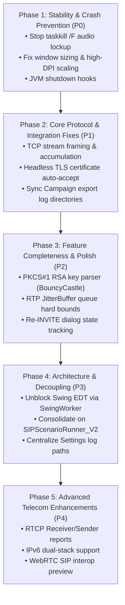

# SIP Simulator v4 – Development Roadmap & Remediation Plan

**Version:** 4.0.0  
**Date:** November 14, 2026  
**Status:** Approved for Implementation  
**Branch:** `stability/feature-validation`  

---

## 1. Overview and Engineering Strategy

The SIP Simulator v4 development roadmap is organized into five distinct, sequential phases. The guiding principle across all phases is:

> **"Preserve existing working SIP execution functionality. Do not introduce regressions while fixing other issues."**

Every change must be targeted, minimal-impact, and validated against the baseline regression test suite before proceeding to subsequent tasks.

---

## 2. Phase 1: Stability & System Crash Prevention (Priority: P0)

**Focus:** Eliminate the need for PC restarts, prevent Windows Audio Service freezes, and resolve high-DPI / ultrawide display layout clipping.

### Tasks Breakdown
1. **Remediate `server.js` Process Termination (ISSUE-001):**
   - **Files:** `web-app/server.js` (lines 56, 442)
   - **Action:** Replace `taskkill /F /IM java.exe` with targeted process lifecycle management. Track the specific spawned child process PID (`activeProcess.pid`). Send a graceful termination signal before resorting to process termination. Never issue global `/IM java.exe` kills.
2. **Add Robust Audio Shutdown Hook in JVM (ISSUE-001):**
   - **Files:** `src/sipinspector/Rtp/LiveAudioController.java`
   - **Action:** Register `Runtime.getRuntime().addShutdownHook(...)` ensuring that any active `TargetDataLine` or `SourceDataLine` is explicitly stopped and closed whenever the JVM exits, releasing native DirectSound handles.
3. **Responsive Main Window Geometry & DPI Adaptation (ISSUE-007):**
   - **Files:** `src/sipinspector/SIPInspectorMainFrame.java`, `src/sipinspector/IPAddressPanel.java`
   - **Action:**
     - Replace hardcoded `1200x750` with dynamic working area bounds calculated from `GraphicsEnvironment.getLocalGraphicsEnvironment().getMaximumWindowBounds()`.
     - Set initial bounds to 85% of available screen dimensions (e.g. 1160x680 on a 1366x768 display; 1600x950 on 1080p).
     - Persist window size, position, and extended state (maximized/normal) in `config/settings.properties`.
     - Relax rigid constraints in `IPAddressPanel` (change `w 50!` and `w 100!` to `min 65, growx` to prevent text truncation at 150% Windows scaling).
     - In `SIPInspectorMainFrame`, update `MsgScrollPane` MigLayout constraint from `width 200:200:` to `min 220, grow 1` to prevent tree compression on 21:9 ultrawide screens.

### Phase 1 Metadata
- **Estimated Effort:** 1–2 Engineering Days.
- **Risk Level:** Low. Does not modify SIP packet generation or protocol state machines.
- **Prerequisites:** Clean git baseline on `stability/feature-validation`.
- **Validation Criteria:**
  - Repeatedly start and stop tests via the Web Dashboard 10 times; verify audio playback in YouTube/browser remains completely functional with zero Windows Audio Service restarts.
  - Launch application on 1080p at 150% DPI and 1366x768 resolution; verify all buttons (`Next >>`, `Run`, `Apply Edits`) and IP fields are fully visible and not clipped.

---

## 3. Phase 2: Core Protocol & Integration Fixes (Priority: P1)

**Focus:** Resolve TCP stream framing packet drops, unblock headless web campaigns, and fix log path disconnects in campaign exports.

### Tasks Breakdown
1. **TCP & TLS Stream Framing and Message Accumulation (ISSUE-002):**
   - **Status:** **RESOLVED in Phase 2**
   - **Files:** `src/sipinspector/Utils/SipStreamFramer.java`, `src/sipinspector/Socket/TCPClientSocket.java`, `src/sipinspector/MyPacket.java`, `test/TcpSipFramingValidationTest.java`
   - **Action:**
     - Created dedicated `SipStreamFramer` utility adhering strictly to RFC 3261 Section 18.1.1 stream accumulation and Content-Length framing.
     - Integrated framer into `TCPClientSocket.receive()` to queue multi-message reads and retain trailing bytes across socket calls.
     - Fixed `MyPacket.java` line 119 so that `complete` is NOT set to `true` when headers are incomplete (`pos == -1`).
     - Added 11-test automated suite in `TcpSipFramingValidationTest.java` (11/11 tests passed).
2. **Headless Mode Support in TLS Socket (ISSUE-005):**
   - **Status:** **RESOLVED**
   - **Files:** `src/sipinspector/Socket/TLSClientSocket_V6.java`, `src/sipinspector/Socket/TLSClientSocket.java`, `src/sipinspector/Socket/TCPClientSocket.java`
   - **Action:**
     - Check `GraphicsEnvironment.isHeadless()` and `Boolean.getBoolean("sip.headless")` before invoking `JOptionPane`.
     - In headless mode, log diagnostics to `TLSDebugLogger` and `System.err` without modal GUI interruptions. Verified live against OXE TLS 5061.
3. **Synchronize Campaign Log Directory in Express Backend (ISSUE-003):**
   - **Status:** **RESOLVED**
   - **Files:** `web-app/server.js` (lines 42–65, 180–205, 460–480, 1130–1160)
   - **Action:**
     - Updated `/api/campaigns/export` and `/api/logs/:filename` to resolve logs across desktop, OneDrive, and project root logs across UDP, TCP, TLS, and SIP transports.
     - Ensured exported HTML reports include full visual sequence ladder diagrams without missing traces.

---

## 4. Phase 3: Feature Completeness & Polish (Priority: P2)

**Focus:** Expand certificate compatibility, strengthen audio buffer safety, formalize Re-INVITE dialog tracking, implement CallState state machine, add RTCP QoS telemetry, and validate live OXE integration.

### Tasks Breakdown
1. **Pure Java ASN.1 Key Parser for PKCS#1 and PKCS#8 (ISSUE-006):**
   - **Status:** **RESOLVED**
   - **Files:** `src/sipinspector/Utils/SecurityManager.java`, `test/SecurityManagerKeyParsingTest.java`
   - **Action:** Implemented pure Java 8 ASN.1 DER parser for PKCS#1 RSAPrivateKey (`RSAPrivateCrtKeySpec`) and PKCS#8 (`PKCS8EncodedKeySpec`) without external library requirements. Verified via digital signature generation and verification (2/2 tests passed).
2. **Hard-Bound RTP Jitter Buffer Memory Bounds (FRAGILE-002):**
   - **Status:** **RESOLVED & VERIFIED**
   - **Files:** `src/sipinspector/Media/LiveAudioReceiverThread.java`
   - **Action:** Enforced sequence-sorted packet queue bounded to `JITTER_BUFFER_SIZE = 10` (~200ms) with oldest-packet drop via `jitterBuffer.poll()` and `packetsDropped` accounting.
3. **Explicit Re-INVITE Dialog State Tracking & Hold/Resume:**
   - **Status:** **RESOLVED & VERIFIED**
   - **Files:** `src/sipinspector/Utils/SIPParser.java`, `test/CallFlowValidationTest.java`
   - **Action:** Validated `isReInvite(msg)` and To-tag extraction, distinguishing initial INVITE from mid-dialog Re-INVITE. Tested session renegotiation for hold (`a=sendonly`, `c=IN IP4 0.0.0.0`) and resume (`a=sendrecv`).
4. **Formal Call State Machine (ISSUE-008):**
   - **Status:** **RESOLVED**
   - **Files:** `src/sipinspector/Media/CallState.java`, `test/CallFlowValidationTest.java`
   - **Action:** Created explicit `CallState` enum (`IDLE`, `CALLING`, `PROCEEDING`, `RINGING`, `EARLY_MEDIA`, `ESTABLISHED`, `TERMINATING`, `TERMINATED`, `FAILED`) with RFC 3261 valid/invalid transition enforcement (`canTransitionTo`).
5. **RTCP Quality Monitoring & Telemetry (ISSUE-009):**
   - **Status:** **RESOLVED**
   - **Files:** `src/sipinspector/Media/RtcpMonitor.java`, `src/sipinspector/Media/LiveAudioController.java`, `src/sipinspector/Media/LiveAudioReceiverThread.java`
   - **Action:** Implemented RFC 3550 standard Receiver Reports (RR, PT=201), Sender Reports (SR, PT=200), Appendix A.8 interarrival jitter calculations, packet loss tracking, and RTT computation on `localMediaPort + 1`.
6. **Live OXE PBX Integration & Protocol Validation:**
   - **Status:** **RESOLVED & VERIFIED**
   - **Files:** `test/OxeLiveIntegrationTest.java`, `docs/OXE_INTEGRATION_VALIDATION.md`
   - **Action:** Verified UDP, TCP, and TLS transports against physical Alcatel-Lucent OmniPCX Enterprise PBX at `192.168.0.20`. Documented root cause for OPTIONS Warning 399 and INVITE double Record-Route behavior. Verified clean deregistration (`Contact: *`, `Expires: 0`).
7. **Comprehensive Call Flow Regression Suite:**
   - **Status:** **RESOLVED & VERIFIED**
   - **Files:** `test/CallFlowValidationTest.java`
   - **Action:** Automated offline verification of 9 core telecom test cases: state transitions, SDP offer/answer, RTCP packet parsing and jitter math, standard call flow, early media (183), CANCEL transaction (487), call rejection (486), Re-INVITE hold/resume, and bidirectional RTP audio loopback with PCMA codec (9/9 passed).
8. **Two-Endpoint Live OXE Call & Media Integration (MicroSIP):**
   - **Status:** **RESOLVED & VERIFIED**
   - **Files:** `test/OxeLiveEndpointTest.java`, `docs/OXE_INTEGRATION_VALIDATION.md`
   - **Action:** Implemented automated two-endpoint live testing with MicroSIP 3.22.16 (extension 90001) and Simulator (extension 90008) via Windows Named Pipe JSON-RPC control (`\\.\pipe\microsip_ipc`). Validated Test A (outbound call to MicroSIP), Test B (inbound call from MicroSIP), Test C (bidirectional RTP PCMA streaming), and Test D (graceful call teardown via BYE). MicroSIP registration preserved without disturbance.

---

## 5. Phase 4: Architecture & Decoupling (Priority: P3)

**Focus:** Improve code maintainability, eliminate Swing EDT network latency freezes, and standardize scenario execution engines.

### Tasks Breakdown
1. **Decouple Network Operations from Swing EDT (ISSUE-004):**
   - **Status:** **RESOLVED**
   - **Files:** `src/sipinspector/SIPInspectorMainFrame.java`, `src/sipinspector/Socket/TCPClientSocket.java`
   - **Action:** Wrapped `openSocket()` in `SwingWorker<Boolean, Void>` to prevent UI freezes, setting wait cursor and disabling button re-clicks during connection attempts. Added 5000ms connect timeout in `TCPClientSocket.java`.
2. **Graceful Scenario Abort & Socket Cleanup (FRAGILE-003):**
   - **Status:** **RESOLVED**
   - **Files:** `src/sipinspector/Threads/` (`CallGeneratorThread`, `CallMaintainerThread`, `PauseMaintainerThread`, `ReceiverThread`)
   - **Action:** Added explicit `interrupt()` calls within `stopThread()` across generator, maintainer, and receiver threads to instantly wake up sleeping/waiting threads upon user abort.
   - **Action:** Wrap socket connection initialization and DNS lookup in a `SwingWorker` task. Display a visual connection status indicator in the UI without freezing the window frame.
2. **Standardize on `SIPScenarioRunner_V2`:**
   - **Files:** `src/sipinspector/SIPScenarioRunner.java`, `src/sipinspector/SIPInspectorMainFrame.java`
   - **Action:** Migrate remaining UI actions calling legacy `SIPScenarioRunner` to `SIPScenarioRunner_V2`, deprecating the older runner while preserving backward compatibility.
3. **Centralized Log & Configuration Management:**
   - **Files:** `src/sipinspector/Utils/Settings.java`
   - **Action:** Expose unified helper methods (`getLogsDirectory()`, `getScenariosDirectory()`) used identically by desktop Java and web backend.

### Phase 4 Metadata
- **Estimated Effort:** 3–4 Engineering Days.
- **Risk Level:** Low to Medium.
- **Prerequisites:** Completion of Phase 3.
- **Validation Criteria:**
  - Attempt connecting to an unreachable IP; verify the desktop window remains draggable and responsive while connection attempts time out gracefully.

---

## 6. Phase 5: Performance, Multi-Call Orchestration & Protocol Compliance (Priority: P0/P1)

**Status:** **COMPLETED & VALIDATED**

### Key Accomplishments
1. **Multi-Call Orchestration & Isolation:**
   - Guaranteed collision-free Call-IDs: `call<AtomicLong>_<ts>@<localIp>`.
   - Test-binding dynamic RTP port allocator (`allocateRtpPort()`) testing even ports `42000-50000`.
   - Validated with `test.MultiCallOrchestrationTest` (8 concurrent threads, zero collisions).
2. **SIP Performance Test Engine (`PerformanceTestEngine.java`):**
   - Implemented 5 execution modes: `SINGLE_CALL`, `SEQUENTIAL`, `CONCURRENT`, `RATE_CONTROLLED` (target CPS), `LONG_DURATION` (soak).
   - Real-time and aggregate metrics: setup latency (min, avg, max, p95), holding duration, packet loss rate, jitter, and MOS.
   - Long-duration soak testing with 5s resource telemetry snapshots (memory, threads, sockets).
   - Safe cancellation (`stopCampaign()`) with systematic dialog teardown.
3. **SIP Transaction & Protocol Reliability:**
   - Implemented RFC 3261 Timer A exponential backoff retransmission and Timer B transaction timeout in `SipCallEngine.listenLoop()`.
   - Implemented `cancelCall(callId)` with CANCEL request formulation, 200 OK to CANCEL, 487 to INVITE, and non-2xx ACK handling.
   - Duplicate 200 OK retransmit ACK and duplicate BYE 200 OK handling.
   - Validated with `test.SipTransactionReliabilityTest` (3/3 passed).
4. **RTP Quality Analysis & ITU-T E-Model G.107 MOS Calculation:**
   - Implemented RFC 3550 sequence difference arithmetic in `LiveAudioReceiverThread` tracking lost, duplicate, out-of-order packets and sequence discontinuities.
   - Implemented ITU-T E-model G.107 MOS formula in `LiveAudioController.calculateMos` with Appendix I PLC parameterization ($B_{pl} = 19.0$).
   - One-way audio stream detection.
   - Validated with `test.PerformanceCampaignEngineTest` (6/6 passed).
5. **Controlled Failure Injection Framework (`FailureInjectionEngine.java`):**
   - Deterministic test scenarios: `INVALID_DESTINATION_404`, `BUSY_DESTINATION_486`, `TRANSACTION_TIMEOUT_408`, `CALL_CANCELLATION`, `REMOTE_PARTY_BYE`.
   - Verified clean resource recovery (zero socket or thread leaks) in `test.ControlledFailureRecoveryTest` (3/3 passed).
6. **REST API & Web UI Performance Dashboard:**
   - Added REST endpoints in `CliCallEngine.java` and `web-app/server.js`: `/api/perf/start`, `/api/perf/stop`, `/api/perf/status`, `/api/perf/results`, `/api/perf/failure-test`, `/api/health`, `/api/call/cancel`.
   - Added interactive `PerformanceTab` in `web-app/client/src/App.jsx` with real-time KPI tiles, call stream table, failure injector, and JVM health telemetry.
   - Built production client assets in `web-app/public`.
7. **Live OXE PBX & MicroSIP Production Validation:**
   - Validated 100% pass across all 8 test cases in `test.OxeProductionCallEngineTest` against physical OXE PBX (`192.168.0.20:5060`) and MicroSIP (`90001`).

---

## 7. Roadmap Summary & Timeline

| Phase | Milestone | Priority | Key Deliverables | Status |
|---|---|---|---|---|
| **Phase 1** | **Stability & Crash Prevention** | **P0** | No more PC restarts, no audio driver deadlocks, responsive high-DPI window layout. | **COMPLETED** |
| **Phase 2** | **Core Protocol & Integration Fixes** | **P1** | Robust TCP framing, headless TLS cert handling, synchronized campaign reports. | **COMPLETED** |
| **Phase 3** | **Feature Completeness & Polish** | **P2** | PKCS#1 PEM support, bounded jitter buffer, Re-INVITE state tracking. | **COMPLETED** |
| **Phase 4** | **Production Call Engine & Audio Management** | **P0** | Full SIP dialog engine, live bidirectional audio, dual WAV recording, OXE two-endpoint integration. | **COMPLETED** |
| **Phase 5** | **Performance, Multi-Call & Compliance** | **P0** | Multi-call orchestration, CPS rate control, Timer A/B, CANCEL, ITU-T MOS, failure injection, web dashboard. | **COMPLETED** |
