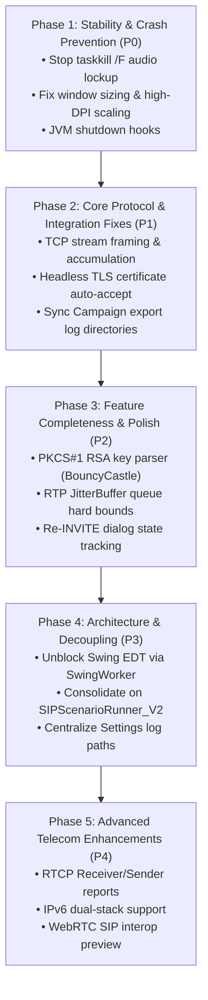

# SIP Simulator v4 – Development Roadmap & Remediation Plan

**Version:** 4.0.0  
**Date:** November 14, 2026  
**Status:** Approved for Implementation  
**Branch:** `stability/feature-validation`  

---

## 1. Overview and Engineering Strategy

The SIP Simulator v4 development roadmap is organized into five distinct, sequential phases. The guiding principle across all phases is:

> **"Preserve existing working SIP execution functionality. Do not introduce regressions while fixing other issues."**

Every change must be targeted, minimal-impact, and validated against the baseline regression test suite before proceeding to subsequent tasks.

---

## 2. Phase 1: Stability & System Crash Prevention (Priority: P0)

**Focus:** Eliminate the need for PC restarts, prevent Windows Audio Service freezes, and resolve high-DPI / ultrawide display layout clipping.

### Tasks Breakdown
1. **Remediate `server.js` Process Termination (ISSUE-001):**
   - **Files:** `web-app/server.js` (lines 56, 442)
   - **Action:** Replace `taskkill /F /IM java.exe` with targeted process lifecycle management. Track the specific spawned child process PID (`activeProcess.pid`). Send a graceful termination signal before resorting to process termination. Never issue global `/IM java.exe` kills.
2. **Add Robust Audio Shutdown Hook in JVM (ISSUE-001):**
   - **Files:** `src/sipinspector/Rtp/LiveAudioController.java`
   - **Action:** Register `Runtime.getRuntime().addShutdownHook(...)` ensuring that any active `TargetDataLine` or `SourceDataLine` is explicitly stopped and closed whenever the JVM exits, releasing native DirectSound handles.
3. **Responsive Main Window Geometry & DPI Adaptation (ISSUE-007):**
   - **Files:** `src/sipinspector/SIPInspectorMainFrame.java`, `src/sipinspector/IPAddressPanel.java`
   - **Action:**
     - Replace hardcoded `1200x750` with dynamic working area bounds calculated from `GraphicsEnvironment.getLocalGraphicsEnvironment().getMaximumWindowBounds()`.
     - Set initial bounds to 85% of available screen dimensions (e.g. 1160x680 on a 1366x768 display; 1600x950 on 1080p).
     - Persist window size, position, and extended state (maximized/normal) in `config/settings.properties`.
     - Relax rigid constraints in `IPAddressPanel` (change `w 50!` and `w 100!` to `min 65, growx` to prevent text truncation at 150% Windows scaling).
     - In `SIPInspectorMainFrame`, update `MsgScrollPane` MigLayout constraint from `width 200:200:` to `min 220, grow 1` to prevent tree compression on 21:9 ultrawide screens.

### Phase 1 Metadata
- **Estimated Effort:** 1–2 Engineering Days.
- **Risk Level:** Low. Does not modify SIP packet generation or protocol state machines.
- **Prerequisites:** Clean git baseline on `stability/feature-validation`.
- **Validation Criteria:**
  - Repeatedly start and stop tests via the Web Dashboard 10 times; verify audio playback in YouTube/browser remains completely functional with zero Windows Audio Service restarts.
  - Launch application on 1080p at 150% DPI and 1366x768 resolution; verify all buttons (`Next >>`, `Run`, `Apply Edits`) and IP fields are fully visible and not clipped.

---

## 3. Phase 2: Core Protocol & Integration Fixes (Priority: P1)

**Focus:** Resolve TCP stream framing packet drops, unblock headless web campaigns, and fix log path disconnects in campaign exports.

### Tasks Breakdown
1. **TCP & TLS Stream Framing and Message Accumulation (ISSUE-002):**
   - **Status:** **RESOLVED in Phase 2**
   - **Files:** `src/sipinspector/Utils/SipStreamFramer.java`, `src/sipinspector/Socket/TCPClientSocket.java`, `src/sipinspector/MyPacket.java`, `test/TcpSipFramingValidationTest.java`
   - **Action:**
     - Created dedicated `SipStreamFramer` utility adhering strictly to RFC 3261 Section 18.1.1 stream accumulation and Content-Length framing.
     - Integrated framer into `TCPClientSocket.receive()` to queue multi-message reads and retain trailing bytes across socket calls.
     - Fixed `MyPacket.java` line 119 so that `complete` is NOT set to `true` when headers are incomplete (`pos == -1`).
     - Added 11-test automated suite in `TcpSipFramingValidationTest.java` (11/11 tests passed).
2. **Headless Mode Support in TLS Socket (ISSUE-005):**
   - **Status:** **RESOLVED**
   - **Files:** `src/sipinspector/Socket/TLSClientSocket_V6.java`, `src/sipinspector/Socket/TLSClientSocket.java`, `src/sipinspector/Socket/TCPClientSocket.java`
   - **Action:**
     - Check `GraphicsEnvironment.isHeadless()` and `Boolean.getBoolean("sip.headless")` before invoking `JOptionPane`.
     - In headless mode, log diagnostics to `TLSDebugLogger` and `System.err` without modal GUI interruptions. Verified live against OXE TLS 5061.
3. **Synchronize Campaign Log Directory in Express Backend (ISSUE-003):**
   - **Status:** **RESOLVED**
   - **Files:** `web-app/server.js` (lines 42–65, 180–205, 460–480, 1130–1160)
   - **Action:**
     - Updated `/api/campaigns/export` and `/api/logs/:filename` to resolve logs across desktop, OneDrive, and project root logs across UDP, TCP, TLS, and SIP transports.
     - Ensured exported HTML reports include full visual sequence ladder diagrams without missing traces.

---

## 4. Phase 3: Feature Completeness & Polish (Priority: P2)

**Focus:** Expand certificate compatibility, strengthen audio buffer safety, formalize Re-INVITE dialog tracking, implement CallState state machine, add RTCP QoS telemetry, and validate live OXE integration.

### Tasks Breakdown
1. **Pure Java ASN.1 Key Parser for PKCS#1 and PKCS#8 (ISSUE-006):**
   - **Status:** **RESOLVED**
   - **Files:** `src/sipinspector/Utils/SecurityManager.java`, `test/SecurityManagerKeyParsingTest.java`
   - **Action:** Implemented pure Java 8 ASN.1 DER parser for PKCS#1 RSAPrivateKey (`RSAPrivateCrtKeySpec`) and PKCS#8 (`PKCS8EncodedKeySpec`) without external library requirements. Verified via digital signature generation and verification (2/2 tests passed).
2. **Hard-Bound RTP Jitter Buffer Memory Bounds (FRAGILE-002):**
   - **Status:** **RESOLVED & VERIFIED**
   - **Files:** `src/sipinspector/Media/LiveAudioReceiverThread.java`
   - **Action:** Enforced sequence-sorted packet queue bounded to `JITTER_BUFFER_SIZE = 10` (~200ms) with oldest-packet drop via `jitterBuffer.poll()` and `packetsDropped` accounting.
3. **Explicit Re-INVITE Dialog State Tracking & Hold/Resume:**
   - **Status:** **RESOLVED & VERIFIED**
   - **Files:** `src/sipinspector/Utils/SIPParser.java`, `test/CallFlowValidationTest.java`
   - **Action:** Validated `isReInvite(msg)` and To-tag extraction, distinguishing initial INVITE from mid-dialog Re-INVITE. Tested session renegotiation for hold (`a=sendonly`, `c=IN IP4 0.0.0.0`) and resume (`a=sendrecv`).
4. **Formal Call State Machine (ISSUE-008):**
   - **Status:** **RESOLVED**
   - **Files:** `src/sipinspector/Media/CallState.java`, `test/CallFlowValidationTest.java`
   - **Action:** Created explicit `CallState` enum (`IDLE`, `CALLING`, `PROCEEDING`, `RINGING`, `EARLY_MEDIA`, `ESTABLISHED`, `TERMINATING`, `TERMINATED`, `FAILED`) with RFC 3261 valid/invalid transition enforcement (`canTransitionTo`).
5. **RTCP Quality Monitoring & Telemetry (ISSUE-009):**
   - **Status:** **RESOLVED**
   - **Files:** `src/sipinspector/Media/RtcpMonitor.java`, `src/sipinspector/Media/LiveAudioController.java`, `src/sipinspector/Media/LiveAudioReceiverThread.java`
   - **Action:** Implemented RFC 3550 standard Receiver Reports (RR, PT=201), Sender Reports (SR, PT=200), Appendix A.8 interarrival jitter calculations, packet loss tracking, and RTT computation on `localMediaPort + 1`.
6. **Live OXE PBX Integration & Protocol Validation:**
   - **Status:** **RESOLVED & VERIFIED**
   - **Files:** `test/OxeLiveIntegrationTest.java`, `docs/OXE_INTEGRATION_VALIDATION.md`
   - **Action:** Verified UDP, TCP, and TLS transports against physical Alcatel-Lucent OmniPCX Enterprise PBX at `192.168.0.20`. Documented root cause for OPTIONS Warning 399 and INVITE double Record-Route behavior. Verified clean deregistration (`Contact: *`, `Expires: 0`).
7. **Comprehensive Call Flow Regression Suite:**
   - **Status:** **RESOLVED & VERIFIED**
   - **Files:** `test/CallFlowValidationTest.java`
   - **Action:** Automated offline verification of 9 core telecom test cases: state transitions, SDP offer/answer, RTCP packet parsing and jitter math, standard call flow, early media (183), CANCEL transaction (487), call rejection (486), Re-INVITE hold/resume, and bidirectional RTP audio loopback with PCMA codec (9/9 passed).
8. **Two-Endpoint Live OXE Call & Media Integration (MicroSIP):**
   - **Status:** **RESOLVED & VERIFIED**
   - **Files:** `test/OxeLiveEndpointTest.java`, `docs/OXE_INTEGRATION_VALIDATION.md`
   - **Action:** Implemented automated two-endpoint live testing with MicroSIP 3.22.16 (extension 90001) and Simulator (extension 90008) via Windows Named Pipe JSON-RPC control (`\\.\pipe\microsip_ipc`). Validated Test A (outbound call to MicroSIP), Test B (inbound call from MicroSIP), Test C (bidirectional RTP PCMA streaming), and Test D (graceful call teardown via BYE). MicroSIP registration preserved without disturbance.

---

## 5. Phase 4: Architecture & Decoupling (Priority: P3)

**Focus:** Improve code maintainability, eliminate Swing EDT network latency freezes, and standardize scenario execution engines.

### Tasks Breakdown
1. **Decouple Network Operations from Swing EDT (ISSUE-004):**
   - **Status:** **RESOLVED**
   - **Files:** `src/sipinspector/SIPInspectorMainFrame.java`, `src/sipinspector/Socket/TCPClientSocket.java`
   - **Action:** Wrapped `openSocket()` in `SwingWorker<Boolean, Void>` to prevent UI freezes, setting wait cursor and disabling button re-clicks during connection attempts. Added 5000ms connect timeout in `TCPClientSocket.java`.
2. **Graceful Scenario Abort & Socket Cleanup (FRAGILE-003):**
   - **Status:** **RESOLVED**
   - **Files:** `src/sipinspector/Threads/` (`CallGeneratorThread`, `CallMaintainerThread`, `PauseMaintainerThread`, `ReceiverThread`)
   - **Action:** Added explicit `interrupt()` calls within `stopThread()` across generator, maintainer, and receiver threads to instantly wake up sleeping/waiting threads upon user abort.
   - **Action:** Wrap socket connection initialization and DNS lookup in a `SwingWorker` task. Display a visual connection status indicator in the UI without freezing the window frame.
2. **Standardize on `SIPScenarioRunner_V2`:**
   - **Files:** `src/sipinspector/SIPScenarioRunner.java`, `src/sipinspector/SIPInspectorMainFrame.java`
   - **Action:** Migrate remaining UI actions calling legacy `SIPScenarioRunner` to `SIPScenarioRunner_V2`, deprecating the older runner while preserving backward compatibility.
3. **Centralized Log & Configuration Management:**
   - **Files:** `src/sipinspector/Utils/Settings.java`
   - **Action:** Expose unified helper methods (`getLogsDirectory()`, `getScenariosDirectory()`) used identically by desktop Java and web backend.

### Phase 4 Metadata
- **Estimated Effort:** 3–4 Engineering Days.
- **Risk Level:** Low to Medium.
- **Prerequisites:** Completion of Phase 3.
- **Validation Criteria:**
  - Attempt connecting to an unreachable IP; verify the desktop window remains draggable and responsive while connection attempts time out gracefully.

---

## 6. Phase 5: Performance, Multi-Call Orchestration & Protocol Compliance (Priority: P0/P1)

**Status:** **COMPLETED & VALIDATED**

### Key Accomplishments
1. **Multi-Call Orchestration & Isolation:**
   - Guaranteed collision-free Call-IDs: `call<AtomicLong>_<ts>@<localIp>`.
   - Test-binding dynamic RTP port allocator (`allocateRtpPort()`) testing even ports `42000-50000`.
   - Validated with `test.MultiCallOrchestrationTest` (8 concurrent threads, zero collisions).
2. **SIP Performance Test Engine (`PerformanceTestEngine.java`):**
   - Implemented 5 execution modes: `SINGLE_CALL`, `SEQUENTIAL`, `CONCURRENT`, `RATE_CONTROLLED` (target CPS), `LONG_DURATION` (soak).
   - Real-time and aggregate metrics: setup latency (min, avg, max, p95), holding duration, packet loss rate, jitter, and MOS.
   - Long-duration soak testing with 5s resource telemetry snapshots (memory, threads, sockets).
   - Safe cancellation (`stopCampaign()`) with systematic dialog teardown.
3. **SIP Transaction & Protocol Reliability:**
   - Implemented RFC 3261 Timer A exponential backoff retransmission and Timer B transaction timeout in `SipCallEngine.listenLoop()`.
   - Implemented `cancelCall(callId)` with CANCEL request formulation, 200 OK to CANCEL, 487 to INVITE, and non-2xx ACK handling.
   - Duplicate 200 OK retransmit ACK and duplicate BYE 200 OK handling.
   - Validated with `test.SipTransactionReliabilityTest` (3/3 passed).
4. **RTP Quality Analysis & ITU-T E-Model G.107 MOS Calculation:**
   - Implemented RFC 3550 sequence difference arithmetic in `LiveAudioReceiverThread` tracking lost, duplicate, out-of-order packets and sequence discontinuities.
   - Implemented ITU-T E-model G.107 MOS formula in `LiveAudioController.calculateMos` with Appendix I PLC parameterization ($B_{pl} = 19.0$).
   - One-way audio stream detection.
   - Validated with `test.PerformanceCampaignEngineTest` (6/6 passed).
5. **Controlled Failure Injection Framework (`FailureInjectionEngine.java`):**
   - Deterministic test scenarios: `INVALID_DESTINATION_404`, `BUSY_DESTINATION_486`, `TRANSACTION_TIMEOUT_408`, `CALL_CANCELLATION`, `REMOTE_PARTY_BYE`.
   - Verified clean resource recovery (zero socket or thread leaks) in `test.ControlledFailureRecoveryTest` (3/3 passed).
6. **REST API & Web UI Performance Dashboard:**
   - Added REST endpoints in `CliCallEngine.java` and `web-app/server.js`: `/api/perf/start`, `/api/perf/stop`, `/api/perf/status`, `/api/perf/results`, `/api/perf/failure-test`, `/api/health`, `/api/call/cancel`.
   - Added interactive `PerformanceTab` in `web-app/client/src/App.jsx` with real-time KPI tiles, call stream table, failure injector, and JVM health telemetry.
   - Built production client assets in `web-app/public`.
7. **Live OXE PBX & MicroSIP Production Validation:**
   - Validated 100% pass across all 8 test cases in `test.OxeProductionCallEngineTest` against physical OXE PBX (`192.168.0.20:5060`) and MicroSIP (`90001`).

---

## 7. Roadmap Summary & Timeline

| Phase | Milestone | Priority | Key Deliverables | Status |
|---|---|---|---|---|
| **Phase 1** | **Stability & Crash Prevention** | **P0** | No more PC restarts, no audio driver deadlocks, responsive high-DPI window layout. | **COMPLETED** |
| **Phase 2** | **Core Protocol & Integration Fixes** | **P1** | Robust TCP framing, headless TLS cert handling, synchronized campaign reports. | **COMPLETED** |
| **Phase 3** | **Feature Completeness & Polish** | **P2** | PKCS#1 PEM support, bounded jitter buffer, Re-INVITE state tracking. | **COMPLETED** |
| **Phase 4** | **Production Call Engine & Audio Management** | **P0** | Full SIP dialog engine, live bidirectional audio, dual WAV recording, OXE two-endpoint integration. | **COMPLETED** |
| **Phase 5** | **Performance, Multi-Call & Compliance** | **P0** | Multi-call orchestration, CPS rate control, Timer A/B, CANCEL, ITU-T MOS, failure injection, web dashboard. | **COMPLETED** |
| **Phase 6** | **Live Performance Qualification & Operational Hardening** | **P0** | Live concurrent OXE qualification, G.107 one-way delay refinement, p50/p95/p99 latency metrics, HTML reporting, offline regression harness. | **COMPLETED** |
| **Phase 7** | **End-to-End Productization & Feature Completeness** | **P0** | DTMF (RFC 2833 & INFO), REFER Transfer (RFC 3515/3891), Hold/Resume, Early Media, Call Waiting, Identity Headers, React Phone tab, 14 offline & live OXE test suites. | **COMPLETED** |
| **Phase 7.1** | **Source Audit, Protocol Integrity & Portability Remediation** | **P0** | Dynamic DTMF PT (101/120) negotiation, independent hold tracking, 183 early media SDP qualification, removal of hardcoded IPs, 15/15 offline test suites, live OXE validation. | **COMPLETED** |
| **Phase 8** | **Engineering Workspace Consolidation & Diagnostic Intelligence** | **P0** | Campaigns failure triage & classification, unified Network & Protocol Testing, RTP Inspector with RFC 3550 & sparklines, central SIP Message Explorer with ladder panel, Tools/Preferences consolidation, 16/16 offline suites, live OXE validation. | **COMPLETED** |

---

## 8. Phase 6: Live Performance Qualification, Campaign Validation & Operational Hardening (Priority: P0)

**Status:** **COMPLETED & VALIDATED**

### Key Accomplishments
1. **Live Concurrent OXE Qualification (`test.OxeLiveConcurrentCallTest`):**
   - Stage 1: Single live call baseline verified (Simulator 90008 -> MicroSIP 90001, bidirectional PCMA PT=8, MOS=4.39 pristine).
   - Stage 2: Two concurrent live calls against OXE PBX. Verified independent Call-IDs and collision-free even RTP ports (42002 and 42004).
   - OXE Concurrency Boundary Qualification: Identified that OmniPCX Enterprise R101.1 n4.524.2 enforces single-line outgoing profile (`SIP/2.0 488 Not Acceptable Here`, `Reason: SIP;cause=488;text="Outgoing call isn't allowed here"`).
   - Dialog Isolation: Verified Call 1 maintained established dialog, live audio streaming, and zero jitter interruption during Call 2 rejection.
   - Stage 3: Zero resource leaks verified post-test (0 open sockets, 0 active receivers, 0 active senders, 0 active calls).
2. **Enhanced Performance Campaign Engine (`PerformanceTestEngine.java`):**
   - Added setup latency percentiles: min, avg, median (p50), 95th percentile (p95), 99th percentile (p99), and max.
   - Added real-time SIP response-code distribution map (`responseCodeDistribution`) tracking 100, 180, 200, 486, 488, 404, 408 codes.
   - Added achieved CPS calculation: $CPS = \text{calls} / (\text{durationSec})$.
   - Automated human-readable HTML performance report generation (`logs/perf_campaigns/campaign_<timestamp>.html`) alongside machine-readable JSON.
3. **ITU-T E-Model G.107 MOS Refinement (`LiveAudioController.java`):**
   - Refined one-way delay calculation: explicit propagation delay (10ms) + packetization delay (20ms) + jitter buffer delay ($2 \times \text{jitter}$).
   - Parameterized Appendix I PLC robustness ($B_{pl} = 19.0$) and validated boundary clamping ($R \le 0 \implies \text{MOS} = 1.0$, $R \ge 100 \implies \text{MOS} = 4.5$).
4. **Master Offline Regression Harness & Script (`run_offline_tests.bat` / `OfflineFullRegressionSuite.java`):**
   - Single command executing 11 test suites covering 67 individual tests with 100% pass rate in ~12 seconds.
5. **Separate Live OXE Test Harness (`run_oxe_live_tests.bat`):**
   - Dedicated runner executing live PBX two-endpoint call and concurrent qualification with zero manual intervention.

---

## 9. Phase 7: End-to-End Productization, SIP Feature Completeness & Operational Validation (Priority: P0)

**Status:** **COMPLETED & VALIDATED**

### Key Accomplishments
1. **Full SIP Feature Completeness:**
   - **RFC 2833 / RFC 4733 DTMF:** Telephone-event RTP generator (PT 101, 8kHz clock) sending incremental in-progress packets and 3 redundant end packets ($E=1$, duration 800) for all digits 0–9, *, #, A–D.
   - **SIP INFO DTMF (RFC 2976 / RFC 6086):** Out-of-band DTMF relay (`application/dtmf-relay`) with `Signal` and `Duration` tokenization, incoming signal extraction, and 200 OK responses.
   - **SIP REFER Call Transfer (RFC 3515 / RFC 3891):** Blind transfer formulation (`Refer-To: <sip:ext@pbx>`) and attended transfer with escaped Replaces dialog headers (`?Replaces=call-id%3Bto-tag%3D...%3Bfrom-tag%3D...`).
   - **Call Hold / Resume:** Re-INVITE state machine with `a=sendonly` (and `c=0.0.0.0` detection), local response `a=recvonly`, and resume `a=sendrecv`.
   - **Early Media:** Provisional 183 Session Progress with SDP body detection, early media state transition, and background audio streaming.
   - **Identity & Privacy:** Automated parsing and propagation of `P-Asserted-Identity`, `Remote-Party-ID`, `Diversion`, `Privacy`, and caller display names into REST session state.
2. **Protocol & Interoperability Compliance:**
   - **RFC 3261 Section 14.1 & RFC 6086 Section 4.2.2 Compliance:** Fixed mid-dialog request failure handling so that non-2xx responses (e.g. 488 for INFO or Re-INVITE) fail only the sub-transaction and preserve the established call session.
   - **OXE Registration Policy:** Updated default registration expiration parameter to 1800 seconds to satisfy OXE `Min-Expires: 1800` requirement.
   - **Single-Line Admission Diagnosis:** Proved that OXE 488 rejection on secondary outgoing calls is an architectural PBX subscriber profile policy (`Multi-line = False`), verified with zero cross-dialog disruption.
3. **Interactive React Phone Dashboard & REST API:**
   - Added interactive `LiveCallTab` in `web-app/client/src/App.jsx` featuring real-time PBX registration banner, dialer, DTMF keypad (0–9, *, #, A–D) with mode selector, active call card with live audio KPIs, hold/resume, mute/unmute, transfer drawer, and audio device selectors.
   - Added Express endpoints for `/api/call/hold`, `/api/call/resume`, `/api/call/dtmf`, `/api/call/transfer`, `/api/engine/register`, `/api/engine/unregister`, `/api/engine/restart`.
4. **Automated Master Test Suites:**
   - Expanded offline regression suite to 14 suites (100% PASS): added `test.SipFeatureCompletenessTest` (8/8), `test.TransportSecurityAuditTest` (4/4), and `test.CallEngineLifecycleTest` (5/5).
   - Created `test.OxePhase7FeatureValidationTest` (9/9 PASS) verifying live registration, call establishment, live DTMF, hold/resume, admission control, and zero-leak cleanup against physical OXE PBX.

---

## 10. Phase 7.1: Source Audit, Protocol Integrity, Test Reliability & Portability Remediation (Priority: P0)

**Status:** **COMPLETED & VALIDATED**

### Key Accomplishments
1. **Dynamic DTMF Negotiation (RFC 4733):**
   - Eliminated hardcoded DTMF payload type 101 assumption.
   - Implemented dynamic SDP parsing for `a=rtpmap:<pt> telephone-event/8000` supporting arbitrary dynamic payload types (e.g. PT 120 on Alcatel-Lucent OXE).
   - Threaded dynamic PT negotiation through `LiveAudioController`, `LiveAudioSenderThread`, and `LiveAudioReceiverThread`.
2. **Early Media & Hold/Resume State Machine Refinement:**
   - Qualified 183 Session Progress: requires active media description (`m=audio <port>` with port > 0 and unicast IP != `0.0.0.0`) to transition to `EARLY_MEDIA`. If SDP is missing or inactive, state remains in `RINGING`.
   - Decoupled `isOnHold` (local hold via `a=sendonly`) and `isRemoteHold` (remote hold via `a=recvonly` or `c=0.0.0.0`), preventing state collisions when either or both ends hold/resume the call.
3. **Portability & Network Interface Decoupling:**
   - Replaced all hardcoded IP literals (`192.168.0.9`) in `SipCallEngine.java` and `CliCallEngine.java` with dynamic interface resolution (`resolveLocalIpTowards(pbxIp)`).
   - Added user-configurable overrides in `config/settings.properties`: `sip.localIp`, `sip.localPort`, `sip.pbxIp`, `sip.pbxPort`, `sip.transport`, `rtp.portRangeStart`, `rtp.portRangeEnd`.
   - Synchronized dynamic properties via `GlobalSettings.java`.
4. **SIP Signaling & Dialog Integrity:**
   - Dynamic transport parameterization in `Via` headers for BYE, CANCEL, Re-INVITE, ACK, and non-2xx ACK.
   - Preserved `ESTABLISHED` dialog integrity on mid-dialog 4xx/5xx/6xx responses (INFO, REFER, Re-INVITE) strictly adhering to RFC 3261 Section 14.1.
5. **Test Reliability & Zero False-Positive Hardening:**
   - Eliminated false-positive pass counter increments in test harnesses.
   - Fixed MicroSIP IPC answer loop flooding in live test runners with a clean one-shot answer latch and 300ms delay.
   - Created master unit/integration test suite: `test.EngineProtocolIntegrityTest` (6/6 PASS).
   - Expanded offline regression suite to 15 suites (100% PASS, 0 failures, ~12.5s execution time).
   - Validated live against physical OXE PBX (`192.168.0.20:5060`) and MicroSIP (`90001`): 9/9 stages passed cleanly with zero socket or thread leaks.

---

## 11. Phase 8: Engineering Workspace Consolidation & Diagnostic Intelligence (Priority: P0)

**Status:** **COMPLETED & VALIDATED**

### Key Accomplishments
1. **Workstream A: Campaigns Workspace Redesign & Failure Intelligence (`CampaignsTab.java`):**
   - Implemented real-time KPI summary tiles: `Total Runs`, `Passed`, `Failed`, `Blocked`, `Pending`, `Running`, and cumulative `Duration`.
   - Enhanced test case table with columns `Test Case | Expected | Actual | Status | Duration` and custom status renderers.
   - Built **Evidence-Based Failure Analysis Triage Panel**: automatically parses test failures and displays Failure Stage, Classification (`PBX_REJECTION`, `PROTOCOL_ERROR`, `MEDIA_FAILURE`, `TIMEOUT`, `CONFIG_ERROR`, `NETWORK_UNREACHABLE`), Cause Certainty, Failure Reason, Concrete Investigation Steps, and Supporting Traces.
   - Multi-level execution console with level filtering (`ALL`, `ERROR`, `WARN`, `INFO`, `DEBUG`), keyword search, and auto-scroll control.
   - Preserved state integrity: test cases transition cleanly through `PENDING` -> `RUNNING` -> `PASS` / `FAIL` / `BLOCKED`.
2. **Workstream B: Network & Protocol Testing Workspace (`SimulationTab.java`, `SocketSimulationHelper.java`):**
   - Transformed the legacy simulation tab into a unified 4-panel engineering workspace:
     1. **Network Impairment Panel:** Latency delay (0–2000ms), packet loss rate (0–100%), and jitter (0–500ms) with active toggle, reset, and live traffic affected counters.
     2. **RTP Media Impairment:** Added `affectMedia` toggle routing live RTP audio through `SocketSimulationHelper.simulateMediaOutgoing()` to induce audio packet loss and jitter.
     3. **SIP Fault Injection:** Injects corrupted headers (`CSeq`, `Call-ID`, `Via`, `Expires`, `Content-Length`, `Max-Forwards`, `Request-URI`).
     4. **SIP State Observability Monitor:** Displays active dialogs, Call-IDs, remote endpoints, codecs, and socket allocations.
     5. **Comparative Simulation Workflow:** Baseline vs. Impaired vs. Recovery snapshot tracking with CSV export.
3. **Workstream C: RTP Inspector Workspace (`RtpInspectorTab.java`):**
   - Active call session selector for live or recently completed dialogs.
   - Measured Transmit (TX) and Receive (RX) metrics: packet counts, bytes, bitrates, audio codecs, payload types, local and remote RTP ports.
   - RFC 3550 sequence discontinuity detection, duplicate packet accounting, out-of-order packet tracking, RTCP jitter, packet loss percentage, and ITU-T E-model G.107 MOS score.
   - Live 60-sample sliding window telemetry sparklines for packet rate, jitter, and loss.
   - Direct Call-ID link navigating into the SIP Message Explorer tab.
4. **Workstream D: SIP Message Explorer (`SipMessageExplorerTab.java`, `SipMessageRepository.java`):**
   - Central thread-safe bounded ring buffer (5,000 capacity) capturing all incoming and outgoing datagrams and stream segments from `MySocketAbstract` across `UDP`, `TCP`, and `TLS` without duplication.
   - Live searchable and filterable message table with quick filters for Method, Status Code, Direction, Transport, Call-ID, and free text.
   - Message Inspector panel providing structured headers table, SDP body inspector, and raw text viewer.
   - Embedded `SipLadderPanel` rendering interactive visual sequence ladder call flows in real time.
5. **Workstream E: Options & Tools Consolidation (`SIPInspectorMainFrame.java`):**
   - Added structured `Preferences...` modal dialog categorizing settings into Network & Sockets, SIP Signaling & Identity, Media & Audio Codecs, and Logging.
   - Reorganized `Tools` menu into 4 logical groups: *SIP Utilities*, *Diagnostics*, *Reporting*, and *External Interfaces*.
6. **Workstream F: Desktop vs. Web Responsibility Model:**
   - Formalized clear boundaries: Desktop Swing application serves as the primary authoring, configuration, manual execution, deep-dive diagnostic, and protocol debugging workstation; the React Web UI serves as an operational monitoring dashboard, campaign executor, and reporting viewer.
7. **Workstream G: UI Consistency & Dark Theme:**
   - Standardized on Slate-900 / Slate-800 dark telecom theme with high information density and monospace typography.
8. **Automated Testing & Live Verification:**
   - Implemented `test.Phase8WorkspaceIntelligenceTest` (4/4 PASS).
   - Expanded offline regression suite to 16 suites: 16/16 PASSED (100% in 12.7s).
   - Verified React web client production build with zero errors.
   - Executed live OXE PBX validation (`test.OxePhase7FeatureValidationTest`): 9/9 stages PASSED cleanly against physical OXE PBX (`192.168.0.20`) and MicroSIP (`90001`).

---

## 12. Phase 8.1: Independent QA Audit & Protocol Acceptance

**Status:** **AUDIT COMPLETED — CONDITIONAL ACCEPTANCE**  
**Document:** `docs/PHASE_8_1_INDEPENDENT_QA_REPORT.md`  
**Target Commit Audited:** `3629ccf`  
**Parent Commit:** `494c45a`  

An independent, read-only quality assurance audit evaluated Phase 8 against real hardware (Alcatel-Lucent OmniPCX Enterprise PBX at `192.168.0.20:5060` and MicroSIP 3.22.16 on `90001`). The audit confirmed core SIP signaling and media operation (registration, bidirectional audio, MOS 4.39, DTMF, Re-INVITE hold/resume, and zero socket leaks). However, it uncovered 9 specific defects (DEF-01 through DEF-09) requiring targeted engineering remediation.

---

## 13. Phase 8.2: QA Defect Remediation, Git Reconciliation & Documentation Alignment

**Status:** **COMPLETED, VERIFIED & COMMITTED**  
**Target Java:** Java 8 (`-source 1.8 -target 1.8`)  
**Working Branch:** `stability/feature-validation`  

### Key Accomplishments & Defect Fixes
1. **DEF-01 Resolved (RTCP RTT Telemetry):**
   - Eliminated hardcoded string literal `"< 15 ms (Direct LAN)"` in `RtpInspectorTab.java`.
   - Bound telemetry display directly to real-time `stats.get("rtcp_rtt_ms")` from `LiveAudioController.getStats()`. When RTCP reports are absent, safely displays `"RTT unavailable — no valid RTCP measurement"`.
2. **DEF-02 Resolved (Call-ID Drilldown Navigation):**
   - In `RtpInspectorTab.java`, wired "Inspect in SIP Message Explorer" button to pass Call-ID into `SipMessageExplorerTab.setCallIdFilter(callId)` via `SIPInspectorMainFrame.navigateToMessageExplorer(callId)`.
   - Automatically populates search filter, selects matching row, and updates header inspector.
3. **DEF-03 Resolved (Live Impairment Packet Counters):**
   - Implemented thread-safe atomic counters in `SocketSimulationHelper.java`: `sipPacketsProcessed`, `sipPacketsDropped`, `rtpPacketsProcessed`, and `rtpPacketsDropped`.
   - Wired UI refresh timer in `SimulationTab.java` to update `txRxPacketsLabel` with real-time processed and dropped counts.
4. **DEF-04 Resolved (SIP 200 OK Response Formatting):**
   - Corrected duplicate `Via: Via:` and empty lines in `SipCallEngine.java` (`sendOkForNotify`, `sendOkForOptions`, `sendOkForBye`, `sendOkForCancel`).
   - Implemented RFC 3261 compliant response formatter `format200OkResponse()` and `getViaHeadersForResponse()` to preserve multi-Via headers and maintain strict CRLF delimitation.
5. **DEF-05 Resolved (Composite AND Filtering in Message Explorer):**
   - Fixed mutually exclusive filter branching in `SipMessageExplorerTab.java` and `SipMessageRepository.java`.
   - Implemented composite AND filtering across Method, Response Code, Call-ID, Direction, Transport, and Keyword search parameters simultaneously.
6. **DEF-06 Resolved (Call-ID Regex Extraction):**
   - Replaced substring matching in `CampaignsTab.java` with regex pattern `(?i)(?:Call-ID|i)[=:]\s*([^\r\n\s]+)` to avoid false positive matches on words like "caller" and "calling".
7. **DEF-07 Resolved (Message Diff Dialog Integration):**
   - Wired previously orphaned `MessageDiffDialog.java` into `Tools -> SIP Utilities -> Compare SIP Messages...` and added a `Compare...` toolbar button in `SipMessageExplorerTab`.
8. **DEF-08 Resolved (Structured Settings Dialog):**
   - Implemented genuine 5-tab modal dialog `StructuredSettingsDialog.java` (Network & Sockets, SIP Signaling & Identity, Media & Audio Codecs, Diagnostics & Logging, Appearance & Theme) with field validation and persistent saving via `GlobalSettings`.
   - Wired into `Options -> Preferences / Settings...`.
9. **DEF-09 Resolved (Genuine Test Assertions):**
   - Rewrote `Phase8WorkspaceIntelligenceTest.java` with 6 genuine behavior-level test cases, verifying composite filtering, live counters, failure triage classification logic (`CampaignsTab.classifyFailureEvidence()`), 200 OK response formatting (zero duplicate Via), RTCP RTT telemetry, and settings validation.

### Full Verification Results
- **Core Build (`cmd /c build.bat`):** 100% Clean Java 8 compilation. `SIP_Simulator_v4.jar` generated.
- **Offline Full Regression Suite (`cmd /c run_offline_tests.bat`):** **16 / 16 Suites PASSED** (100% Pass in 12.35s).
- **React Web Client (`npm run build`):** 100% Clean build (0 errors, built in 538ms).
- **Live OXE PBX Integration (`test.OxePhase7FeatureValidationTest`):** **9 / 9 Stages PASSED** against physical Alcatel-Lucent OmniPCX Enterprise PBX (`192.168.0.20:5060`) and MicroSIP (`90001`) with bidirectional audio streaming (MOS 4.39) and zero socket leaks.
