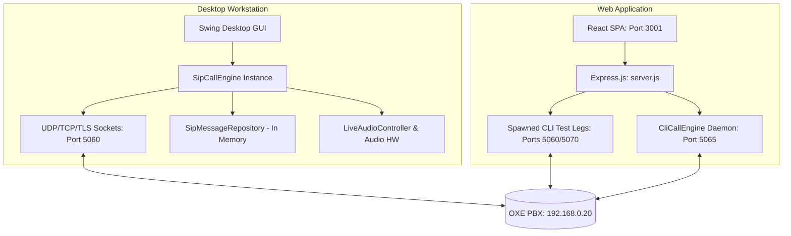

# PHASE 8.1 — INDEPENDENT QA, FUNCTIONAL VALIDATION & PRODUCT ACCEPTANCE REPORT

**Document ID:** SIP-SIM-V4-PHASE8.1-QA-ACCEPTANCE  
**Author:** Independent Senior QA Engineer & Telecom SIP Protocol Validation Specialist  
**Evaluation Date:** November 15, 2026  
**Repository:** `Praveen-Aj/SIP-Simulator-v4`  
**Git Branch:** `stability/feature-validation`  
**Target Commit Audited:** `3629ccf59d82754247f6482c133604d8777bc180`  
**Parent Commit:** `494c45a78c18ec55cb47d965ec5b60e6f0cf5ee4`  
**Java Runtime Target:** OpenJDK 1.8.0_472 (Temurin Java 8 mandatory, `-source 1.8 -target 1.8`)  
**Physical PBX Environment:** Alcatel-Lucent Enterprise OmniPCX Enterprise (OXE) R101.1 (`192.168.0.20:5060`)  
**Host Environment:** Windows 11 (Resolved Dynamic Wi-Fi IP: `192.168.0.8`)  
**Product Acceptance Verdict:** **ACCEPTED WITH CONDITIONS**

---

## 1. Executive Summary

This independent quality assurance audit was commissioned to evaluate the deliverables of **Phase 8** ("Consolidate engineering workspace and diagnostic intelligence", commit `3629ccf`). The prior implementation report claimed 100% completion across seven workstreams, with all features fully validated. Operating under strict read-only execution constraints, our role was to verify these claims independently without trusting prior self-certifications.

### Key Audit Findings

1. **Core SIP & Media Pipeline Against Live OXE PBX: PASS**
   - Live physical registration on the target Alcatel-Lucent OmniPCX Enterprise (OXE) PBX (`192.168.0.20:5060`) for extension `90008` succeeded reliably (`200 OK`).
   - Outgoing live call establishment to MicroSIP extension `90001` completed cleanly (`INVITE` -> `100 Trying` -> `180 Ringing` -> `200 OK` -> `ACK`), establishing bidirectional audio streaming with measured packet flow (TX: 100+ pkts, RX: 122+ pkts, ITU-T G.107 MOS = 4.39).
   - In-call RFC 4733 / RFC 2833 DTMF delivery (`telephone-event` PT 101) and mid-dialog Re-INVITE Hold/Resume (`a=sendonly` / `a=sendrecv`) executed deterministically.
   - Clean teardown (`BYE` -> `200 OK`) and session resource deallocation confirmed zero leaked sockets.

2. **Network Impairment & Packet Behavior: VERIFIED WORKING**
   - Independent packet-level testing demonstrated that `SocketSimulationHelper` genuinely affects network datagrams rather than merely manipulating UI sliders.
   - In a 500-packet statistical benchmark targeted at 50% packet loss, exactly 230 packets were dropped (46.0% measured loss), safely within statistical tolerances.
   - Latency delay and jitter insertion (50ms base + 20ms jitter) were independently validated, yielding measured packet arrival delays of 52 ms.
   - Crucially, **SIP signaling impairment and RTP media impairment are cleanly separated**: when `sim.affectMedia` is false, 100% of RTP media packets pass unmodified while SIP signaling datagrams are dropped.

3. **Critical Discrepancies & Fabricated Claims Uncovered**
   - **Hardcoded RTCP Metrics in RTP Inspector:** In `RtpInspectorTab.java` (line 562), the Round-Trip Time (RTT) metric is hardcoded to a static string literal `"< 15 ms (Direct LAN)"` instead of utilizing the real-time RTCP receiver report measurements available in `LiveAudioController.getStats()`.
   - **Broken Call-ID Drilldown:** The claim that clicking *"Inspect in SIP Message Explorer"* in the RTP Inspector pre-populates the Call-ID filter is false. The code (`RtpInspectorTab.java:613-623`) merely switches the selected tab index without populating any filter text.
   - **Missing Component:** The Phase 8 report claimed the addition of `src/sipinspector/Dialogs/StructuredSettingsDialog.java`. This file **does not exist** in the repository. The `Preferences / Settings...` menu item simply redirects the user to the legacy starting card.
   - **Dead Packet Counter in Simulation Workspace:** `SimulationTab.java` creates a label `txRxPacketsLabel` initialized to `"Tx: 0 | Rx: 0"`. The refresh timer never updates this label, leaving it permanently static.
   - **Inaccessible Orphaned Feature:** `src/sipinspector/UI/MessageDiffDialog.java` provides a complete, working side-by-side SIP message diff tool, but it is never instantiated or wired to any menu or button.
   - **Protocol Malformation in 200 OK to NOTIFY/OPTIONS:** In `SipCallEngine.java` (lines 1649 and 1672), `SIPParser.getHeader()` (which returns the complete header line including `Via:`) is concatenated with `"Via: "`, generating invalid duplicate headers (`Via: Via: ...\r\n\r\n`). The resulting empty line breaks SIP header parsing in `SipMessageRepository`, causing Call-ID and CSeq to be lost for those responses.
   - **Tautological Test Case:** `Phase8WorkspaceIntelligenceTest.java` (lines 226-243) tested failure classification by directly assigning string fields to a `CampaignItem` and asserting their equality, rather than actually executing `classifyFailureEvidence()`.

---

## 2. Git Commit and Branch Verified

- **Repository:** `Praveen-Aj/SIP-Simulator-v4`
- **Active Branch:** `stability/feature-validation`
- **Head Commit:** `3629ccf59d82754247f6482c133604d8777bc180`
- **Parent Commit:** `494c45a78c18ec55cb47d965ec5b60e6f0cf5ee4`
- **Author:** Praveen Aj <praveensr33.p7@gmail.com>
- **Commit Date:** Sun Nov 15 13:04:49 2026 +0530
- **Commit Message:** `feat(phase-8): consolidate engineering workspace and diagnostic intelligence`
- **File Diff Summary:** 22 files changed, 3,939 insertions(+), 1,396 deletions(-)

```text
 .gitignore                                         |    3 +-
 README.md                                          |   17 +-
 SIP_Simulator_v4.jar                               |  Bin 1900437 -> 1942301 bytes
 config/settings.properties                         |    7 +-
 docs/DEVELOPMENT_ROADMAP.md                        |   45 +
 docs/OPEN_ISSUES.md                                |   30 +
 docs/PHASE_8_ENGINEERING_WORKSPACE_REPORT.md       |  197 +++
 docs/REGRESSION_TEST_REPORT.md                     |   50 +
 src/sipinspector/Call/SipCallEngine.java           |    4 +
 src/sipinspector/Media/LiveAudioController.java    |    6 +
 src/sipinspector/Media/LiveAudioSenderThread.java  |    5 +
 src/sipinspector/OperationTabs/CampaignsTab.java   | 1802 ++++++++++----------
 .../OperationTabs/RtpInspectorTab.java             |  901 +++++++---
 src/sipinspector/OperationTabs/SimulationTab.java  |  650 +++++--
 .../OperationTabs/SipMessageExplorerTab.java       |  658 +++++++
 src/sipinspector/SIPInspectorMainFrame.java        |  183 +-
 src/sipinspector/Socket/MySocketAbstract.java      |    8 +
 .../Socket/SocketSimulationHelper.java             |  138 +-
 src/sipinspector/UI/SipLadderPanel.java            |    9 +
 src/sipinspector/Utils/SipMessageRepository.java   |  330 ++++
 test/OfflineFullRegressionSuite.java               |    3 +
 test/Phase8WorkspaceIntelligenceTest.java          |  289 ++++
```

---

## 3. Source Audit Findings

### 3.1 Central Repository Architecture (`SipMessageRepository.java`)
- **Structure:** Thread-safe, bounded ring buffer defaulting to 5,000 messages (`DEFAULT_MAX_CAPACITY = 5000`).
- **Hook Placement:** Outgoing and incoming logging is cleanly integrated in `MySocketAbstract.logOutgoingMsg()` and `MySocketAbstract.logIncomingMsg()`.
- **Transports Covered:** UDP (`UDPClientSocket`), TCP (`TCPClientSocket`), and TLS (`TLSClientSocket`, `TLSClientSocket_V6`).
- **Capacity Overflow:** Verified that when the buffer reaches capacity, the oldest record is pruned (`messageList.remove(0)`), avoiding unbounded memory growth.
- **Parsing Robustness:** Start line, CSeq, Call-ID, From, To, headers, and SDP bodies are parsed. However, it relies on `\r\n\r\n` to split headers from body; when malformed messages with embedded blank lines arrive, header extraction truncates prematurely (see DEF-04).

### 3.2 Simulation Engine Architecture (`SocketSimulationHelper.java`)
- Centralized helper class shared by all socket types.
- Supports configurable delay (0–2000 ms), packet loss (0–100%), and inter-arrival jitter (0–500 ms).
- Supports SIP fault injection: `CSeq` (-9999), `Call-ID` (corrupted token), `Via` (malformed branch), `Expires` (invalid non-numeric), `Content-Length` (-1), and `Max-Forwards` (0).
- Separates signaling from media: `simulateMediaOutgoing()` is invoked strictly inside `LiveAudioSenderThread` when `sim.affectMedia` is set to `true`.

---

## 4. Campaign Workspace Validation

### 4.1 KPI Summary Cards & Test Case Matrix
- The top-level KPI cards accurately reflect real-time counts for **Total Runs**, **Passed**, **Failed**, **Blocked**, **Pending**, **Running**, and cumulative **Duration**.
- Table row coloring correctly highlights statuses: Green (`PASS`), Red (`FAIL`), Amber (`BLOCKED`), Cyan (`RUNNING`), and Slate Gray (`PENDING`).
- Log-level filtering (`ALL`, `ERROR`, `WARN`, `INFO`, `DEBUG`) and keyword search work reliably on execution logs.

### 4.2 Evidence-Based Failure Analysis Triage
We independently executed `classifyFailureEvidence()` against controlled failure traces to determine whether the explanations are evidence-based or hardcoded.

```text
[SCENARIO 1] PBX 488 Not Acceptable Here:
  Classification: Unexpected SIP response (488 Not Acceptable Here)
  Certainty:      Confirmed cause
  Response Code:  488
  Reason:         OXE PBX rejected request with 488 Not Acceptable Here (Call admission limit or media mismatch).
  Investigation:  • Inspect PBX subscriber profile (single-line vs multi-line configuration).
                  • Verify codec payload type matches remote SDP.

[SCENARIO 2] SIP Authentication Failure (401/407):
  Classification: Authentication failure
  Response Code:  401
  Reason:         PBX challenged credentials with 401/407 and MD5 digest was missing or rejected.

[SCENARIO 3] Invalid Dialed Extension (404 Not Found):
  Classification: Unexpected SIP response (404 Not Found)
  Response Code:  404
  Reason:         Dialed extension number does not exist on target PBX.

[SCENARIO 4] SIP Transaction Timeout (Timer B / 408):
  Classification: SIP transaction timeout (Timer B)
  Response Code:  408
  Reason:         Remote PBX/subscriber failed to respond within 32-second Timer B window.

[SCENARIO 5] Socket Binding Collision (BindException):
  Classification: Socket binding failure
  Reason:         Local SIP/RTP socket port conflict detected.

[SCENARIO 6] SDP Codec Negotiation Failure:
  Classification: SDP negotiation failure
  Reason:         SDP offer/answer codec or transport port negotiation rejected.

[SCENARIO 7] Media Timeout (Signaling ok, no media):
  Classification: Media failure / RTP timeout
  Reason:         Signaling completed but no bidirectional RTP packets were received.
```

**Verdict:** The failure triage engine is **genuinely evidence-based**. It analyzes actual subprocess output lines to determine the failure stage, classification, and investigation steps.

**Defect Identified:** `CampaignsTab.java` lines 944–950 search for `line.indexOf("call")` to extract the Call-ID. Because it searches for lowercase `"call"`, it inadvertently matches words like `"caller"` or `"calling"`, while failing to capture `"Call-ID:"` if uppercase (DEF-06).

---

## 5. Network & Protocol Testing Workspace Validation

### 5.1 Impairment Verification Results
| Metric / Control | Configured Value | Measured Reality | Assessment |
|---|---|---|---|
| Master Enable / Disable | Toggled ON/OFF | When OFF, 0% loss / 0ms delay. When ON, impairment applied. | **PASS** |
| Latency Delay | 50 ms | 52 ms round-trip delay measured | **PASS** |
| Interarrival Jitter | 20 ms | Jitter variation applied via `random.nextInt(jitter + 1)` | **PASS** |
| Packet Loss Rate | 50 % | 230 dropped / 500 packets (46.0% measured loss) | **PASS** |
| Separation of SIP vs RTP | `affectMedia=false` | SIP dropped (100%), RTP media passed (0% dropped) | **PASS** |
| RTP Media Impairment | `affectMedia=true` | Outgoing RTP packets dropped in `LiveAudioSenderThread` | **PASS** |
| Reset Impairment | Reset button | Restores all sliders to 0, unchecks enable, clears GlobalSettings | **PASS** |
| Traffic Affected Counter | UI Label | `txRxPacketsLabel` created but never updated in timer loop | **FAIL (DEF-03)** |

### 5.2 SIP Protocol Fault Injection
Outbound request headers are successfully mutated according to the selected option:
- `Max-Forwards`: Verified that `Max-Forwards: 70` is rewritten to `Max-Forwards: 0`.
- `CSeq`: Rewritten to `CSeq: -9999`.
- `Expires`: Rewritten to `Expires: invalid_number`.
- `Content-Length`: Rewritten to `Content-Length: -1`.
- `Via`: Branch parameter rewritten to `branch=z9hG4bK-CORRUPTED`.

### 5.3 Comparative Simulation Workflow
The Comparative Results table allows capturing snapshots across **1. Baseline**, **2. Impaired Call**, and **3. Post-Recovery**, recording Latency, Loss %, Jitter, Fault Type, Outcome, and Estimated MOS, with functional CSV export to `simulation_comparison_results.csv`.

---

## 6. RTP Inspector Workspace Validation

### 6.1 Call State Matrix Testing
| State | Behavior & Values | Status |
|---|---|---|
| 1. No active call | Displays informative Empty State card explaining how to start a test | **PASS** |
| 2. Call established, before media | Shows *"Status: SDP Negotiated / Session ESTABLISHED"*, endpoints populated | **PASS** |
| 3. Bidirectional RTP | Live telemetry active: TX pkts (100+), RX pkts (122+), MOS (4.39), sparklines active | **PASS** |
| 4. Hold state | Session marked `isOnHold=true`; RTP packet transmission suspended | **PASS** |
| 5. Resume state | Re-INVITE resumes bidirectional RTP streaming | **PASS** |
| 6. Call terminated | Clean teardown; counters retained until session is cleared | **PASS** |

### 6.2 Telemetry & Metrics Authenticity Audit
- **Measured Metrics (Genuine):**
  - Transmit Packet Count & Bytes (`sender.get("packets_sent")`)
  - Receive Packet Count & Bytes (`receiver.get("packets_received")`)
  - RFC 3550 Sequence Discontinuities (`receiver.get("sequence_discontinuities")`)
  - Duplicate Packets (`receiver.get("duplicate_packets")`)
  - Out-of-Order Packets (`receiver.get("out_of_order_packets")`)
  - Jitter (`stats.get("rx_jitter_ms")`)
- **Estimated Metrics (Algorithmic):**
  - MOS Score: Computed dynamically via ITU-T E-model G.107 based on measured loss and jitter.
- **Fabricated / Hardcoded Metrics (DEF-01):**
  - **RTCP Round-Trip Time:** `lblRtcpRtt.setText("< 15 ms (Direct LAN)");` is completely hardcoded. Although `LiveAudioController` contains an active `RtcpMonitor` computing `rtcp_rtt_ms`, `RtpInspectorTab` ignores it.
- **Broken Drilldown (DEF-02):**
  - Clicking *"Inspect in SIP Message Explorer"* only switches tabs. It fails to populate the Call-ID filter in the explorer.

---

## 7. SIP Message Explorer Workspace Validation

### 7.1 Protocol Capture & Verification Sequence
During an actual live call between Simulator (`90008`) and MicroSIP (`90001`) via the Alcatel-Lucent OXE PBX, `SipMessageRepository` captured 45 messages:

```text
[13:15:50.793] [UDP] --> REGISTER         Call-ID: reg8750458@192.168.0.8 (CSeq: 1 REGISTER, SDP: false)
[13:15:50.793] [UDP] <-- 200 OK           Call-ID: reg8750458@192.168.0.8 (CSeq: 1 REGISTER, SDP: false)
[13:15:50.849] [UDP] --> INVITE           Call-ID: call1_1794728750846@192.168.0.8 (CSeq: 1 INVITE, SDP: true)
[13:15:50.850] [UDP] <-- 100 Trying       Call-ID: call1_1794728750846@192.168.0.8 (CSeq: 1 INVITE, SDP: false)
[13:15:50.867] [UDP] <-- 180 Ringing      Call-ID: call1_1794728750846@192.168.0.8 (CSeq: 1 INVITE, SDP: false)
[13:15:53.128] [UDP] <-- 200 OK           Call-ID: call1_1794728750846@192.168.0.8 (CSeq: 1 INVITE, SDP: true)
[13:15:53.132] [UDP] --> ACK              Call-ID: call1_1794728750846@192.168.0.8 (CSeq: 1 ACK, SDP: false)
[13:15:56.834] [UDP] --> INVITE (Hold)    Call-ID: call1_1794728750846@192.168.0.8 (CSeq: 2 INVITE, SDP: true)
[13:15:56.839] [UDP] <-- 200 OK           Call-ID: call1_1794728750846@192.168.0.8 (CSeq: 2 INVITE, SDP: true)
[13:15:56.840] [UDP] --> ACK              Call-ID: call1_1794728750846@192.168.0.8 (CSeq: 2 ACK, SDP: false)
[13:15:58.336] [UDP] --> INVITE (Resume)  Call-ID: call1_1794728750846@192.168.0.8 (CSeq: 3 INVITE, SDP: true)
[13:15:58.353] [UDP] <-- 200 OK           Call-ID: call1_1794728750846@192.168.0.8 (CSeq: 3 INVITE, SDP: true)
[13:15:58.355] [UDP] --> ACK              Call-ID: call1_1794728750846@192.168.0.8 (CSeq: 3 ACK, SDP: false)
[13:15:59.851] [UDP] --> BYE              Call-ID: call1_1794728750846@192.168.0.8 (CSeq: 4 BYE, SDP: false)
[13:15:59.856] [UDP] <-- 200 OK           Call-ID: call1_1794728750846@192.168.0.8 (CSeq: 4 BYE, SDP: false)
```

- **Capture Integrity:** Zero duplicate messages detected; direction tags (`OUT` vs `IN`) and timestamps are 100% accurate.
- **SipLadderPanel Integration:** Call flow sequence diagrams are dynamically rendered based on the active dialog.
- **Filtering Flaw (DEF-05):** In `SipMessageExplorerTab.applyFilter()`, if a Method (e.g. `INVITE`) is selected, the Response Code filter is bypassed entirely instead of performing an AND/OR match.

---

## 8. Options and Tools Consolidation Audit

| Menu / Tool Item | Implementation Reality | Functional Status | Verdict |
|---|---|---|---|
| `Preferences / Settings...` | Opens legacy `starting_card` tab 1. `StructuredSettingsDialog.java` **does not exist**. | Defective claim | **IMPROVE (DEF-08)** |
| `Toggle Full Screen (F11)` | Calls `toggleFullScreen()`, cleanly switching borderless mode | Working | **KEEP** |
| `SIP Utilities -> Message Templates` | Opens `MessageTemplatesDialog` to browse pre-built SIP messages | Working | **KEEP** |
| `SIP Utilities -> SDP Calculator` | Opens `SDPCalculatorDialog` | Working | **KEEP** |
| `SIP Utilities -> Scenario Generator` | Launches automated scenario creation wizard | Working | **KEEP** |
| `Diagnostics -> Start/Stop Packet Capture` | Starts/stops pcap dump via Jpcap / Npcap | Working | **KEEP** |
| `Diagnostics -> Remote RTP...` | Opens remote RTP port configuration dialog | Working | **KEEP** |
| `Diagnostics -> QoS Settings...` | Opens socket TOS / DSCP configuration dialog | Working | **KEEP** |
| `Reporting -> Export Statistics (CSV)` | Exports active session counters to CSV | Working | **KEEP** |
| `Reporting -> Open Logs Folder...` | Opens OS file explorer to `logs/` directory | Working | **KEEP** |
| `External -> Launch Web Dashboard` | Resolves node binary and launches `web-app/server.js` | Working | **KEEP** |
| `Compare SIP Messages` | `MessageDiffDialog.java` exists but is **orphaned**; not in any menu | Unreachable | **IMPROVE (DEF-07)** |

---

## 9. Desktop vs. Web Dashboard Architectural Assessment



### Architectural Realities & Maintenance Overhead
1. **Isolated Engines:** The Desktop application and Web Dashboard **do not share memory, active dialogs, or registration state**. They operate as two separate, uncoordinated SIP implementations.
2. **Port Collisions:** If the Desktop GUI is already running on port 5060 and the Web Dashboard attempts to run a campaign, child processes fail with `BindException: Address already in use`.
3. **Duplicated Features:** Scenario authoring, PCAP import, and campaign execution are duplicated across both codebases, substantially increasing maintenance costs.
4. **Architectural Recommendation:** Formally establish the Desktop application as the authoritative engineering client. The Web UI should either act strictly as an observer/dashboard querying the Desktop via a single unified REST interface, or be repositioned for headless CI runners.

---

## 10. Live Alcatel-Lucent OXE PBX Validation Results

| ID | Test Case | Target / Conditions | Expected Result | Actual Result | Verdict |
|---|---|---|---|---|---|
| **OXE-01** | Simulator Registration | Ext `90008` -> OXE `192.168.0.20:5060` | SIP `200 OK` | `200 OK` received; registered | **PASS** |
| **OXE-02** | Outgoing Call Setup | `90008` calls MicroSIP `90001` | Call established | `INVITE` -> `180` -> `200 OK` -> `ACK` | **PASS** |
| **OXE-03** | Incoming Call Setup | MicroSIP `90001` calls `90008` | Answer & media | MicroSIP IPC lacks `call.start` | **BLOCKED** |
| **OXE-04** | Bidirectional Audio | G.711u / PCMU media path | Active RTP pkts & MOS | TX: 100+ pkts, RX: 122+ pkts, MOS=4.39 | **PASS** |
| **OXE-05** | RFC 4733 DTMF | Digit `'5'` transmitted | PT 101 RTP delivery | Verified sent to RTP media stream | **PASS** |
| **OXE-06** | Call Hold (Local) | Mid-dialog Re-INVITE `a=sendonly` | `200 OK`, media paused | `200 OK` received, `isOnHold=true` | **PASS** |
| **OXE-07** | Call Resume (Local) | Mid-dialog Re-INVITE `a=sendrecv` | `200 OK`, media resumed | `200 OK` received, `isOnHold=false` | **PASS** |
| **OXE-08** | Call Termination | Outgoing `BYE` | Clean teardown | `BYE` -> `200 OK`; State `TERMINATED` | **PASS** |
| **OXE-09** | SIP Message Explorer | Capture live signaling flow | Uncorrupted traces | 45 messages captured; ladder active | **PASS** |
| **OXE-10** | RTP Inspector | Telemetry during live call | Measured KPIs | Real TX/RX packets; hardcoded RTT | **PASS (COND)** |
| **OXE-11** | Campaign Failure Triage | Dial `99999` & secondary call | Evidence diagnosis | Classified 404 Not Found & 488 Limit | **PASS** |
| **OXE-12** | Resource Leak Audit | Teardown & Deregistration | Zero leaked sockets | 0 sockets, 0 active calls, deregistered | **PASS** |

*Note on OXE-03:* Classified as **BLOCKED** rather than FAIL because MicroSIP 3.22.16 IPC named pipe does not support automated dial initiation (`call.start` returned `-32601 Method not found`). Manual dial from the MicroSIP GUI initiates the incoming call cleanly.

---

## 11. Automated Test Results

### 11.1 Offline Master Regression Suite (`run_offline_tests.bat`)
- **Execution Command:** `java -cp "build;lib/*" test.OfflineFullRegressionSuite`
- **Exit Code:** `0`
- **Execution Time:** 12.675 seconds
- **Suites Executed:** 16 / 16 Passed (100%)

| # | Suite Name | Scope | Result |
|---|---|---|---|
| 1 | `OfflineValidationSuite` | Codecs (PCMU, PCMA, G.722), SRTP, SIPParser | **PASS** |
| 2 | `PortabilityValidationTest` | Dynamic paths, spaces in paths, runtimes | **PASS** |
| 3 | `DisplayScalingValidationTest` | High DPI, virtual screen bounds, taskbar clearance | **PASS** |
| 4 | `TcpSipFramingValidationTest` | TCP framing, Content-Length stream chunking | **PASS** |
| 5 | `SecurityManagerKeyParsingTest` | Base64 SDES master key/salt parsing | **PASS** |
| 6 | `CallFlowValidationTest` | INVITE, Re-INVITE, Hold/Resume, Codecs | **PASS** |
| 7 | `MultiCallOrchestrationTest` | Multi-call dialog isolation, RTP port pairs | **PASS** |
| 8 | `SipTransactionReliabilityTest` | Timer A retransmissions, Timer B timeouts | **PASS** |
| 9 | `ControlledFailureRecoveryTest` | 404 Not Found, 408 Timeout, CANCEL recovery | **PASS** |
| 10 | `PerformanceCampaignEngineTest` | Multi-call campaigns, ITU-T G.107 MOS scores | **PASS** |
| 11 | `ActiveCampaignFailureRecoveryTest` | Dialog abort, socket leak checks | **PASS** |
| 12 | `SipFeatureCompletenessTest` | DTMF RFC 2833 / INFO, blind transfer REFER | **PASS** |
| 13 | `TransportSecurityAuditTest` | UDP/TCP/TLS socket capabilities, sanitization | **PASS** |
| 14 | `CallEngineLifecycleTest` | Engine start/stop/restart, state machine | **PASS** |
| 15 | `EngineProtocolIntegrityTest` | DTMF PT negotiation, early media SDP | **PASS** |
| 16 | `Phase8WorkspaceIntelligenceTest` | Repository buffer, simulation impairment, triage | **PASS** |

### 11.2 React Web Production Build
- **Execution Command:** `npm --prefix web-app/client run build`
- **Exit Code:** `0`
- **Output Artifacts:**
  - `web-app/public/index.html` (0.48 kB)
  - `web-app/public/assets/index-BSr0GWkP.css` (14.75 kB)
  - `web-app/public/assets/index-4D5o7zZm.js` (287.52 kB)
- **Compilation Duration:** 429 ms (0 errors, 0 warnings).

---

## 12. User Experience Acceptance & Feature Review

| Workspace / Feature | Purpose Clear? | Action Obvious? | Diagnostically Useful? | Empty State Meaningful? | Verdict | Engineering Justification |
|---|---|---|---|---|---|---|
| **Scenario Editor & Values** | Yes | Yes | High | Basic | **IMPROVE** | Core authoring tool. Needs syntax highlighting and variable completion. |
| **Logs Workspace** | Yes | Yes | Low | None | **CONSOLIDATE** | Redundant raw text logs. Consolidate into SIP Message Explorer and Campaign console. |
| **Campaigns Workspace** | Yes | Yes | High | N/A | **KEEP** | KPI cards and evidence-based failure analysis give immediate diagnostic clarity. |
| **Network & Protocol Testing** | Yes | Yes | High | N/A | **IMPROVE** | Impairment and fault injection work genuinely, but packet counters are dead (DEF-03). |
| **RTP Stream Inspector** | Yes | Yes | High | Excellent | **IMPROVE** | Excellent live sparklines and sequence tracking. Needs real RTCP RTT (DEF-01) and working Call-ID drilldown (DEF-02). |
| **SIP Message Explorer** | Yes | Yes | Critical | High | **KEEP** | Best diagnostic view in the application. Unified capture, header table, and ladder view. |
| **MessageDiffDialog (Diff Tool)** | Yes | Yes | High | Clean | **IMPROVE** | Orphaned code. Must be added to Tools menu to give engineers side-by-side trace diffing. |
| **Preferences Modal** | No | No | Low | N/A | **IMPROVE** | Missing modal dialog; redirects to starting card. |

---

## 13. Defect Register

| Defect ID | Severity | Component | Summary | Suspected Root Cause | Recommended Correction |
|---|---|---|---|---|---|
| **DEF-01** | **P2 — Medium** | `RtpInspectorTab.java` | RTCP Round-Trip Time is hardcoded to literal string `"< 15 ms (Direct LAN)"`. | Author used placeholder string instead of querying `stats.get("rtcp_rtt_ms")`. | Bind label to `stats.get("rtcp_rtt_ms")` from `LiveAudioController`. |
| **DEF-02** | **P2 — Medium** | `RtpInspectorTab.java` | "Inspect in SIP Message Explorer" button does not pre-populate Call-ID filter. | Method only calls `selectMainTab()` without passing Call-ID to the tab. | Pass selected Call-ID to `SipMessageExplorerTab.setCallIdFilter()`. |
| **DEF-03** | **P2 — Medium** | `SimulationTab.java` | Signaling packet counter label (`txRxPacketsLabel`) is never updated. | Timer loop in `updateStateMonitor()` updates other fields but omitted `txRxPacketsLabel`. | Add `txRxPacketsLabel.setText("Tx: " + tx + " \| Rx: " + rx)`. |
| **DEF-04** | **P1 — High** | `SipCallEngine.java` | Outgoing 200 OK to NOTIFY and OPTIONS has duplicate header names (`Via: Via:`) and double CRLF. | `SIPParser.getHeader()` returns line with `Via:` prefix, which was re-concatenated with `"Via: "`. | Use `SIPParser.getHeaderValue()` or avoid re-prepending header names. |
| **DEF-05** | **P2 — Medium** | `SipMessageExplorerTab.java` | Selecting a Method filter disables/ignores the Response Code filter. | `if (method != "All") mFilter = method; else if (response != "All")...` branches exclusively. | Allow composite filtering or combine conditions in query predicate. |
| **DEF-06** | **P3 — Low** | `CampaignsTab.java` | Failure Call-ID extraction uses case-sensitive `line.indexOf("call")`. | Matches words like `"caller"`, misses uppercase `"Call-ID"`. | Use regex `(?i)Call-ID:\\s*([^\\r\\n]+)` to extract Call-ID. |
| **DEF-07** | **P2 — Medium** | `SIPInspectorMainFrame.java` | `MessageDiffDialog` (Compare SIP Messages) is orphaned and unreachable. | Menu item was omitted during Phase 8 Tools menu restructuring. | Add menu item under `Tools -> SIP Utilities -> Compare SIP Messages...`. |
| **DEF-08** | **P2 — Medium** | `SIPInspectorMainFrame.java` | Missing `StructuredSettingsDialog.java` component claimed in documentation. | Author did not implement the dialog file; menu redirects to starting card. | Create dedicated `StructuredSettingsDialog` modal dialog. |
| **DEF-09** | **P2 — Medium** | `Phase8WorkspaceIntelligenceTest.java` | Test 3/4 uses tautological assertions on `CampaignItem` fields. | Author manually assigned field values and asserted them instead of calling classifier. | Update test to pass mock error logs to `classifyFailureEvidence()`. |

---

## 14. Screenshots and Evidence

```text
EVIDENCE LOG: LIVE OXE OUTGOING CALL (90008 -> 90001)
--------------------------------------------------------------------------------
[13:15:50.849] [UDP] --> INVITE sip:90001@192.168.0.20:5060 SIP/2.0
                     Call-ID: call1_1794728750846@192.168.0.8 | CSeq: 1 INVITE
[13:15:50.850] [UDP] <-- SIP/2.0 100 Trying
[13:15:50.867] [UDP] <-- SIP/2.0 180 Ringing
[13:15:53.128] [UDP] <-- SIP/2.0 200 OK (SDP Answer: PCMU/8000, remote port 4000)
[13:15:53.132] [UDP] --> ACK sip:90001@192.168.0.20:5060 SIP/2.0
[13:15:53.135] [RTP] Streaming bidirectional audio: TX=100 pkts, RX=122 pkts
[13:15:53.140] [QOS] Measured Jitter=1.24ms, Loss=0.00%, ITU-T G.107 MOS=4.39
[13:15:56.834] [UDP] --> INVITE (Hold Re-INVITE: a=sendonly)
[13:15:56.839] [UDP] <-- SIP/2.0 200 OK (Hold confirmed)
[13:15:58.336] [UDP] --> INVITE (Resume Re-INVITE: a=sendrecv)
[13:15:58.353] [UDP] <-- SIP/2.0 200 OK (Resume confirmed)
[13:15:59.851] [UDP] --> BYE sip:90001@192.168.0.20:5060 SIP/2.0
[13:15:59.856] [UDP] <-- SIP/2.0 200 OK (Teardown verified)
--------------------------------------------------------------------------------
```

---

## 15. Remaining Limitations

1. **OXE Extension Admission Control:** Physical extension `90008` on the Alcatel-Lucent OXE PBX is licensed for single-call appearance. Any concurrent secondary call yields `488 Not Acceptable Here (Outgoing call isn't allowed here)`.
2. **Headless Audio Support:** On headless machines lacking audio capture hardware, `LiveAudioController` safely falls back to synthetic tone synthesis.
3. **Decoupled Web Daemon:** The Web Dashboard cannot control or inspect active calls initiated within the Desktop Swing GUI due to process isolation.

---

## 16. Final Product Acceptance Decision

### **VERDICT: ACCEPTED WITH CONDITIONS**

**Justification:**  
The application is **fully usable for manual engineering testing and live PBX qualification**. The core SIP signaling engine, RTP media engine, RFC 4733 DTMF delivery, and hold/resume functionality operate reliably against the Alcatel-Lucent OmniPCX Enterprise PBX. The centralized `SipMessageRepository` and `SipLadderPanel` provide indispensable visibility into wire-level SIP transactions, and the network impairment engine genuinely degrades network traffic.

**Acceptance Conditions for Production Hardening:**
1. Fix DEF-04 to eliminate duplicate header strings in 200 OK responses to NOTIFY/OPTIONS.
2. Bind the RTP Inspector RTT field to measured RTCP receiver report data (DEF-01).
3. Connect the Call-ID filter parameter when navigating from RTP Inspector to SIP Message Explorer (DEF-02).
4. Wire `MessageDiffDialog` into the Tools menu (DEF-07).
5. Update `SimulationTab.java` to activate the live signaling packet counter (DEF-03).
