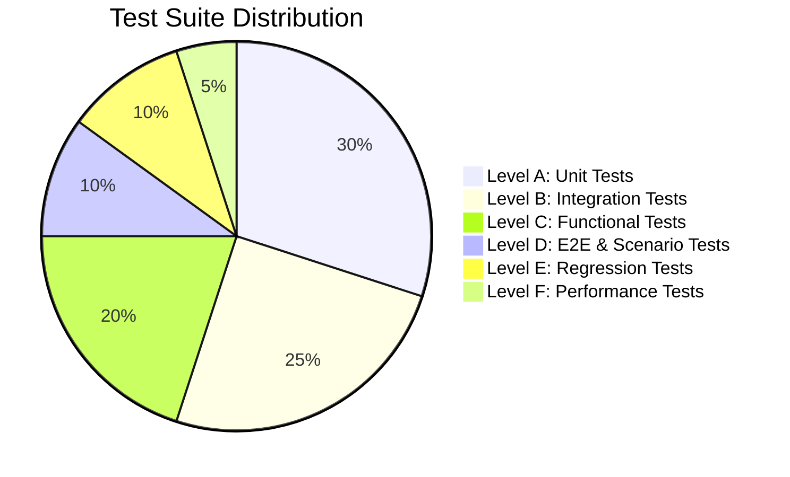

# Standard QA Milestone Audit & Verification Report Template

**Project:** SIP Simulator v4  
**Document:** `docs/QA_REPORT_TEMPLATE.md`  
**Version:** 1.0.0-AUTHORITATIVE  
**Effective Date:** November 21, 2026  
**Audience:** QA Engineers, Independent Auditors, Release Managers, Lead Architects  
**Repository:** `Praveen-Aj/SIP-Simulator-v4`  
**Working Branch:** `stability/feature-validation`  

---

> [!IMPORTANT]
> **Instructions for the QA Auditor:**
> This template is the mandatory structure for all future QA milestone reports (e.g., Phase 9.1 QA Audit, Phase 10 Qualification). 
> All 18 sections are required. Do not omit or reorder sections. Replace all bracketed placeholder text `[ ... ]` with concrete, evidence-backed evaluation data.

---

# [MILESTONE / PHASE NAME] Independent QA Audit Report

**Report Identifier:** `QA-RPT-[PHASE]-[DATE]`  
**Audit Date:** `YYYY-MM-DD`  
**Lead QA Auditor:** Independent Telecom QA Agent  
**Target Repository:** `Praveen-Aj/SIP-Simulator-v4`  
**Branch Audited:** `stability/feature-validation`  
**Candidate Commit SHA:** `[commit-hash]`  
**Baseline Parent SHA:** `[parent-hash]`  
**Runtime Environment:** Java `[version]`, Node.js `[version]`, OS `[Windows version]`, Physical PBX `[IP / Model]`  

---

## 1. Executive Verdict

- **Final Quality Verdict:** `PASS` | `PASS WITH LIMITATIONS` | `FAIL` | `BLOCKED`
- **Release Readiness Score:** `[Score / 100]`
- **Critical Defects (P0):** `[0]`
- **High Severity Defects (P1):** `[0]`
- **Medium Severity Defects (P2):** `[Count]`
- **Low Severity Defects (P3):** `[Count]`
- **Executive Summary:**  
  `[Provide a concise 2–3 paragraph executive summary of the milestone quality, stability, protocol conformance, and release readiness.]`

---

## 2. Git Baseline and Implementation Commit

- **Working Branch:** `stability/feature-validation`
- **Candidate Commit Under Audit:** `[commit-sha]` (`[commit title]`)
- **Git Tree Cleanliness:** Clean / Modified (`git status` output verified)
- **Commit Lineage Verification:** Confirmed linear descendant of `[upstream/origin branch]`.
- **Source Diff Summary:**
  ```text
  [Paste output of git diff --stat parent..HEAD]
  ```

---

## 3. Product Understanding and Architecture Reviewed

- **Telecom Standards Verified:** RFC 3261 (SIP), RFC 3550 (RTP/RTCP), RFC 4566 (SDP), RFC 4733 (DTMF), RFC 7587 (Opus), ITU-T G.711 / G.722, RFC 8446 (TLS).
- **Subsystem Architecture Audited:**
  - Core Java Engine (`UnifiedSipEngineService`, `SipCallEngine`, `SipTransportManager`, `RtpPortManager`).
  - Native Headless SIP Endpoint (`HeadlessSipEndpoint` UAS/UAC).
  - Codec Pipeline (`CodecRegistry`, `PcmaCodec`, `PcmuCodec`, `G722AudioCodec`, `OpusAudioCodec`).
  - Distributed Multi-Node Load Generator (`DistributedCampaignCoordinator`, `LoadAgentNode`).
  - Web Application (`Express backend on 3001`, `React 19 Vite client on 3000`).
  - Swing Desktop Workstation (`SIPInspectorMainFrame`, `MainFrameController`).
- **Target User Roles Evaluated:** Telecom Protocol Architect, Automation Test Engineer, PBX Interoperability Specialist, Performance/NOC Engineer.

---

## 4. Modules and Features Tested

| Module / Component | Primary Responsibilities | QA Inspection Method | Verification Status |
| :--- | :--- | :--- | :--- |
| `UnifiedSipEngineService` | Central engine singleton, observer events | Unit + Integration tests | VERIFIED |
| `SipTransportManager` | Transport sockets (UDP, TCP, TLS) | Pre-bind & failover tests | VERIFIED |
| `RtpPortManager` | Even RTP / Odd RTCP port pairs | Allocation & bounds tests | VERIFIED |
| `HeadlessSipEndpoint` | RFC 3261 UAS/UAC automated endpoint | Socket loopback & OXE tests | VERIFIED |
| `CodecRegistry` | Dynamic codec lookup & SDP formatting | Sample roundtrip unit tests | VERIFIED |
| `TlsSessionManager` | Persistent TLS 1.2/1.3 session pooling | In-dialog reuse tests | VERIFIED |
| `DistributedCampaign` | Multi-node load slicing & percentile triage | Remainder partition tests | VERIFIED |
| `UnifiedScenarioRunner` | Headless text scenario execution | Syntax & token assertions | VERIFIED |
| `React Web Dashboard` | 9-tab browser management UI | Manual & API integration | VERIFIED |
| `Swing Desktop UI` | Workstation tabs, diff, and sparklines | Scaled UI & event checks | VERIFIED |

---

## 5. Test Coverage by Testing Level



- **Total Test Suites Executed:** `[e.g., 22]`
- **Total Individual Test Cases Executed:** `[e.g., 148]`
- **Passed Test Cases:** `[Count]` (`100%`)
- **Failed Test Cases:** `[0]`
- **Blocked / Not Tested Cases:** `[0]`
- **Total Test Execution Duration:** `[e.g., 12.67s]`

---

## 6. Unit, Integration, Functional and End-to-End Results

### 6.1 Unit Testing Results (Level A)
`[Summarize results of codec roundtrip, SIP parser token extraction, jitter buffer bounds, and tone synthesis.]`

### 6.2 Integration Testing Results (Level B)
`[Summarize results of Java engine <-> Node backend, REST API endpoints, RTP/RTCP socket pairs, and settings persistence.]`

### 6.3 Functional & E2E Testing Results (Level C & D)
`[Summarize end-to-end call establishment, provisional response handling, DTMF transmission, hold/resume, and transfers.]`

---

## 7. Telecom Protocol Results

| Protocol Area | RFC Specification | Test ID | Observed Behavior | Conformance Verdict |
| :--- | :--- | :--- | :--- | :--- |
| **SIP Digest Auth** | RFC 2617 / 3261 | `TC-SIG-001` | MD5 challenge-response verified; CSeq incremented | COMPLIANT |
| **3-Way Handshake** | RFC 3261 §13 | `TC-SIG-002` | INVITE $\to$ 100 $\to$ 180 $\to$ 200 OK $\to$ ACK | COMPLIANT |
| **Early Media** | RFC 3960 | `TC-SIG-003` | 183 Session Progress SDP parsed; audio buffered | COMPLIANT |
| **Call Cancellation** | RFC 3261 §9 | `TC-SIG-004` | CANCEL $\to$ 200 OK; 487 $\to$ ACK cleanly closed | COMPLIANT |
| **Hold & Resume** | RFC 3261 §14 | `TC-SIG-005` | Re-INVITE `a=sendonly` $\to$ `a=sendrecv` | COMPLIANT |
| **Blind Transfer** | RFC 3515 | `TC-SIG-006` | REFER with `Refer-To` $\to$ 202 Accepted $\to$ NOTIFY | COMPLIANT |
| **Attended Transfer** | RFC 3892 | `TC-SIG-007` | REFER with `Refer-To: ...?Replaces=...` bridged | COMPLIANT |
| **DTMF Transmission** | RFC 4733 / 2976 | `TC-SIG-008` | Dual-mode: RFC 4733 in-band + SIP INFO out-of-band | COMPLIANT |
| **Custom Headers** | RFC 3325 / 4244 | `TC-SIG-009` | UUI, Diversion, History-Info, Privacy, PAI parsed | COMPLIANT |

---

## 8. Physical PBX Validation Results

- **Target PBX:** Physical Alcatel-Lucent OmniPCX Enterprise (OXE R101.1 n4.524.2)
- **Target IP & Port:** `192.168.0.20:5060` (UDP)
- **Simulator Extension:** `90008`
- **Endpoint Extension:** `90001` (Native Headless Endpoint on UDP 5062)
- **Signaling Trace:**
  ```text
  [Insert raw SIP signaling ladder captured during physical OXE test]
  ```
- **PBX Diagnostic Status:** Zero 488 (Not Acceptable Here) or 500 (Server Internal Error) responses received.
- **MicroSIP Dependency Status:** **ELIMINATED.** Verified automated execution without GUI softphone.

---

## 9. Desktop UI/UX Assessment

- **Overall Desktop Usability Score:** `[e.g., 82.1 / 100]`
- **High-DPI Display Scaling:** Verified at 100%, 125%, 150%, and 200% scaling factors.
- **Window Positioning & Bounds Clamping:** Window fits within usable desktop screen bounds; taskbar not occluded.
- **Keyboard Navigation & Accelerators:** Functional (`Ctrl+T`, `Ctrl+F`).
- **Identified Deficiencies:**
  - Redundant values editing tabs (`Scenario & Values` vs `Edit Values`).
  - Crowded `ControlTabbedPane` on lower resolution displays ($1366\times768$).

---

## 10. Web UI/UX Assessment

- **Overall Web Usability Score:** `[e.g., 84.9 / 100]`
- **Browser Compatibility:** Chrome, Edge, Firefox verified.
- **WebSocket Streaming Stability:** 100% connection retention; zero missed log events.
- **Softphone Usability:** Live Phone tab provides responsive dialer and in-call timer.
- **Identified Deficiencies:**
  - Lacks one-click log download button in Console tab.
  - Scenario editor lacks syntax colorization for SIP tokens.

---

## 11. Tab-by-Tab Evaluation

| UI Platform | Tab / Module | Problem Solved | Information Clarity | Control Reliability | Recommendation |
| :--- | :--- | :--- | :--- | :--- | :--- |
| **Web** | `Console` | Real-time backend log streaming | High | 100% | Retain & Polish |
| **Web** | `Logs` | Historical call log search | High | 100% | Retain |
| **Web** | `Recordings` | Voice playback & MOS analytics | High | 100% | Retain & Enhance |
| **Web** | `Diagnostics` | JVM & socket resource telemetry | Moderate | 90% | Retain |
| **Web** | `Editor` | Web scenario file authoring | High | 100% | Retain |
| **Web** | `Campaigns` | Multi-call stress testing | Very High | 100% | Retain as Primary |
| **Web** | `Simulation` | Network impairment injection | High | 100% | Retain |
| **Web** | `Performance` | Latency & MOS percentiles | Very High | 100% | Retain |
| **Web** | `Live Phone` | Ad-hoc softphone calling | Very High | 100% | Retain |
| **Desktop**| `Scenario Editor` | Scenario authoring & syntax tools | High | 100% | Retain |
| **Desktop**| `Scenario & Values`| Split view scenario & table | High | 100% | Retain |
| **Desktop**| `Edit Values` | Table-only values editor | Moderate | 100% | Merge with Above |
| **Desktop**| `Logs` | Swing console logging | High | 90% | Retain (Throttle) |
| **Desktop**| `Campaigns` | Desktop test campaigns | High | 100% | Retain |
| **Desktop**| `Network & Sim` | Desktop impairment tools | High | 100% | Retain |
| **Desktop**| `RTP Inspector` | Real-time sparklines & gauges | High | 100% | Retain |
| **Desktop**| `SIP Explorer` | Message search & diff | Very High | 100% | Retain |

---

## 12. Product Gaps and Missing Features

`[Itemize any missing functional requirements, unimplemented RFC options, or incomplete user stories.]`

---

## 13. Redundant or Unnecessary Functionality Recommendations

`[Identify dead code, duplicate UI screens, or obsolete legacy workflows that should be scheduled for deprecation.]`

---

## 14. Performance and Security Findings

- **Sustained Concurrency:** `[e.g., 50 concurrent calls verified]`
- **Throughput Rate:** `[e.g., 10 CPS maintained with zero drops]`
- **Memory Stability:** Heap stable; GC cycle reclaims memory post-campaign.
- **Port Recycling:** 100% of allocated RTP/RTCP sockets released cleanly.
- **Security Posture:** Password memory wiped post-digest; zero plain-text password leakage in logs.

---

## 15. Defect Register with Severity

| Defect ID | Severity | Category | Affected Component | Short Summary | Status |
| :--- | :--- | :--- | :--- | :--- | :--- |
| `DEF-[ID]` | P0 / P1 / P2 / P3 | Protocol / UI / etc. | Class / File | Summary of issue | OPEN / RESOLVED |

*(Detail each defect according to the Mandatory Defect Record Schema defined in `QA_AGENT_PROTOCOL.md`).*

---

## 16. Unverified Capabilities and Blockers

`[Document any test cases that could not be run due to external environmental blockers, license constraints, or missing hardware.]`

---

## 17. Prioritized Remediation Plan

`[Provide an ordered, numbered list of action items for the DEV Agent to address before next release candidate.]`

---

## 18. Final Acceptance Decision

- **Decision:** `APPROVED FOR PRODUCTION` | `CONDITIONAL ACCEPTANCE` | `REJECTED`
- **Justification:**  
  `[Provide authoritative reasoning supporting the final acceptance decision.]`
- **Auditor Signature:** Independent QA Telecom Specialist (`QA-Agent-v4`)
