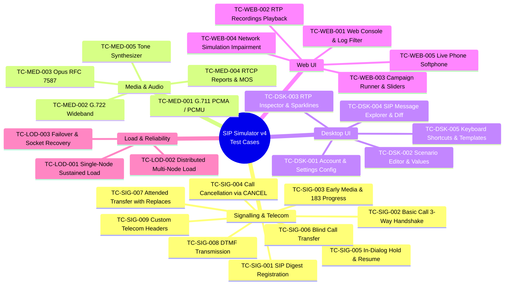

# Master QA Test Case Repository & Workflow Specifications

**Project:** SIP Simulator v4  
**Document:** `docs/QA_TEST_CASES.md`  
**Version:** 1.0.0-AUTHORITATIVE  
**Effective Date:** November 21, 2026  
**Audience:** QA Engineers, Telecom Verification Specialists, Automated Test Developers  
**Repository:** `Praveen-Aj/SIP-Simulator-v4`  
**Working Branch:** `stability/feature-validation`  

---

## 1. Master Test Suite Index

---

## 2. Signalling & Telecom Protocol Test Cases

### TC-SIG-001: SIP Digest Registration and Expiry Refresh
- **Test ID:** `TC-SIG-001`
- **Objective:** Verify RFC 3261 §10 SIP registration with MD5 digest challenge-response against physical OXE PBX and local mock server.
- **Preconditions:** Simulator configured with valid extension (`90008`), password (`90008`), and PBX host (`192.168.0.20:5060`).
- **Test Data:** User: `90008`, Domain: `192.168.0.20`, Expires: `3600`.
- **Step-by-Step Execution:**
  1. Trigger `engine.registerAccount("90008", "90008", "192.168.0.20", 5060, Transport.UDP)`.
  2. Inspect outbound SIP message: verify `REGISTER sip:192.168.0.20 SIP/2.0`, `CSeq: 1 REGISTER`, `Contact: <sip:90008@<local_ip>:5060>`.
  3. Wait for PBX response: verify `401 Unauthorized` with `WWW-Authenticate: Digest realm=..., nonce=...` or immediate `200 OK`.
  4. If `401` received, verify client calculates response `MD5(HA1:nonce:HA2)` and retransmits `REGISTER` with `Authorization` header and `CSeq: 2 REGISTER`.
  5. Verify receipt of `200 OK` with valid `Expires` header.
  6. Verify `engine.isRegistered()` transitions to `true`.
- **Expected Result:** Successful registration without error; registration state updated to `REGISTERED`; renewal timer scheduled.
- **Verification Hook:** `SipCallEngine.isRegistered() == true` and log entry `[SIP REGISTRATION] Registered successfully`.
- **Evidence:** SIP ladder log showing 2-step or 4-step registration handshake.
- **Status:** `AUTOMATED` (`test.OxeLiveHeadlessIntegrationTest`)

---

### TC-SIG-002: Outbound Call Establishment (3-Way Handshake) and Audio Flow
- **Test ID:** `TC-SIG-002`
- **Objective:** Verify complete RFC 3261 §13 outbound call establishment, 200 OK handling, ACK transmission, and bidirectional audio stream binding.
- **Preconditions:** Extension `90008` registered; destination endpoint `90001` available (via `HeadlessSipEndpoint` on UDP 5062).
- **Test Data:** Destination: `90001`, Transport: `UDP`, Codecs: `PCMA, PCMU, G722, Opus`.
- **Step-by-Step Execution:**
  1. Initiate call via `engine.makeCall("90001", "192.168.0.20", 5060, Transport.UDP)`.
  2. Verify initial `INVITE` transmitted with SDP offer containing `c=IN IP4 <local_ip>`, `m=audio <rtp_port> RTP/AVP 8 0 9 111`.
  3. Verify receipt of `100 Trying` (provisional).
  4. Verify receipt of `180 Ringing` (provisional); session state transitions to `RINGING`.
  5. Verify receipt of `200 OK` with SDP answer; session state transitions to `ESTABLISHED`.
  6. Verify client immediately transmits `ACK` targeting Contact URI from 200 OK with identical `Call-ID` and `CSeq: 1 ACK`.
  7. Verify bidirectional RTP packet transmission on negotiated port.
  8. Terminate call via `engine.hangupCall(callId)`.
  9. Verify client transmits `BYE` and receives `200 OK`.
- **Expected Result:** Call establishes cleanly, audio packets exchange in both directions, clean teardown with `BYE` $\to$ `200 OK`.
- **Verification Hook:** `session.getState() == CallState.ESTABLISHED` then `CallState.TERMINATED`.
- **Evidence:** Wireshark PCAP or SIP ladder capture showing complete INVITE-ACK-BYE lifecycle.
- **Status:** `AUTOMATED` (`test.OxeLiveHeadlessIntegrationTest`)

---

### TC-SIG-003: Early Media and 183 Session Progress Handling
- **Test ID:** `TC-SIG-003`
- **Objective:** Verify handling of early media when PBX or gateway responds with `183 Session Progress` containing SDP before 200 OK.
- **Preconditions:** Simulator registered; UAS configured to provide early ringback media.
- **Test Data:** Destination: `90001`, Provisional Code: `183 Session Progress`.
- **Step-by-Step Execution:**
  1. UAC transmits `INVITE`.
  2. UAS responds with `183 Session Progress` containing valid SDP offer/answer (`m=audio <uas_rtp> RTP/AVP 8`).
  3. Verify UAC parses SDP in `183` and immediately initializes RTP receiver socket.
  4. Verify incoming early audio (ringback tone) is buffered and playable before 200 OK.
  5. UAS transmits `200 OK`.
  6. UAC transmits `ACK`.
- **Expected Result:** Audio socket activates upon receipt of `183 Session Progress`; early media flows without truncation.
- **Verification Hook:** `session.getState() == CallState.EARLY_MEDIA` and RTP packets received count $> 0$.
- **Evidence:** SIP ladder log with 183 and early RTP packet timestamp trace.
- **Status:** `READY`

---

### TC-SIG-004: Call Cancellation via CANCEL Prior to Answer
- **Test ID:** `TC-SIG-004`
- **Objective:** Verify RFC 3261 §9 call cancellation before final response.
- **Preconditions:** Extension `90008` registered; destination endpoint ringing (`180 Ringing`).
- **Test Data:** Call-ID: unique auto-generated, CSeq: `1 INVITE`.
- **Step-by-Step Execution:**
  1. Transmit `INVITE`.
  2. Receive `100 Trying` and `180 Ringing`.
  3. Prior to `200 OK`, issue `engine.cancelCall(callId)`.
  4. Verify client transmits `CANCEL` matching original `INVITE` Request-URI, Call-ID, To, From, and `CSeq: 1 CANCEL`.
  5. Verify UAS/PBX responds to `CANCEL` with `200 OK`.
  6. Verify UAS/PBX responds to original `INVITE` with `487 Request Terminated`.
  7. Verify client immediately acknowledges `487` with `ACK`.
  8. Verify session state transitions to `CANCELLED` and allocated RTP ports are released.
- **Expected Result:** Call cleanly cancelled; PBX returns 200 OK to CANCEL and 487 to INVITE; all media sockets closed.
- **Verification Hook:** `session.getState() == CallState.CANCELLED` and `rtpManager.getActiveAllocatedCount() == 0`.
- **Evidence:** Signalling trace showing CANCEL $\to$ 200 OK and 487 $\to$ ACK.
- **Status:** `AUTOMATED` (`test.SipFailureRecoveryTest`)

---

### TC-SIG-005: In-Dialog Call Hold and Resume via Re-INVITE
- **Test ID:** `TC-SIG-005`
- **Objective:** Verify session modification using RFC 3261 §14 Re-INVITE for hold (`a=sendonly` or `c=0.0.0.0`) and resume (`a=sendrecv`).
- **Preconditions:** Call established in `CONFIRMED` dialog.
- **Test Data:** Established Call-ID, CSeq increment: `2 INVITE`, `3 INVITE`.
- **Step-by-Step Execution:**
  1. With call active, trigger `engine.holdCall(callId)`.
  2. Verify client transmits Re-INVITE with incremented `CSeq: 2 INVITE`, same `Call-ID`, established To/From tags.
  3. Verify SDP contains `a=sendonly` (or RFC 2543 `c=IN IP4 0.0.0.0`).
  4. Verify PBX/remote endpoint responds with `200 OK` containing `a=recvonly`.
  5. Verify client sends `ACK`. Outbound RTP stream paused.
  6. Trigger `engine.resumeCall(callId)`.
  7. Verify client transmits Re-INVITE with `CSeq: 3 INVITE` and SDP `a=sendrecv`.
  8. Verify PBX responds with `200 OK` (`a=sendrecv`); client sends `ACK`. Bidirectional audio resumes.
- **Expected Result:** Call transitions between active, held, and resumed states without tearing down the dialog or resetting sockets.
- **Verification Hook:** `session.isHold() == true` then `false`; CSeq increments monotonically.
- **Evidence:** SIP ladder log showing Re-INVITE transactions with SDP attribute diffs.
- **Status:** `AUTOMATED` (`test.SipSignallingIntegrityTest`)

---

### TC-SIG-006: Blind Call Transfer (REFER with Refer-To)
- **Test ID:** `TC-SIG-006`
- **Objective:** Verify RFC 3515 SIP `REFER` blind transfer to a third-party extension.
- **Preconditions:** Call established between Simulator (`90008`) and Target A (`90001`). Target B (`90002`) available.
- **Test Data:** Transfer Target: `sip:90002@192.168.0.20`.
- **Step-by-Step Execution:**
  1. With call active, trigger `engine.transferCall(callId, "90002")`.
  2. Verify client transmits `REFER` in-dialog containing `Refer-To: <sip:90002@192.168.0.20>`.
  3. Verify PBX/Target A responds with `202 Accepted`.
  4. Verify Target A transmits `NOTIFY` with `Event: refer` and `body: SIP/2.0 100 Trying` then `SIP/2.0 200 OK`.
  5. Verify client responds to each `NOTIFY` with `200 OK`.
  6. Verify Target A terminates original session with `BYE`; client responds with `200 OK`.
- **Expected Result:** Original call leg gracefully transferred and torn down; Target B alerted.
- **Verification Hook:** `REFER` sent with valid `Refer-To` header and `202 Accepted` processed.
- **Evidence:** Signalling trace showing REFER $\to$ 202 Accepted $\to$ NOTIFY $\to$ 200 OK $\to$ BYE.
- **Status:** `AUTOMATED` (`test.OxeTelecomInteroperabilityTest`)

---

### TC-SIG-007: Attended Call Transfer (REFER with Replaces Header)
- **Test ID:** `TC-SIG-007`
- **Objective:** Verify RFC 3892 attended transfer replacing an existing consultation dialog.
- **Preconditions:** Call Leg 1 established between `90008` and `90001`. Call Leg 2 established between `90008` and `90002`.
- **Test Data:** Consultation Call-ID, To-tag, and From-tag.
- **Step-by-Step Execution:**
  1. Trigger attended transfer: `engine.transferCallAttended(callId1, callId2)`.
  2. Verify client transmits `REFER` on Call Leg 1 containing:
     `Refer-To: <sip:90002@192.168.0.20?Replaces=<callId2>%3Bto-tag%3D...%3Bfrom-tag%3D...>`.
  3. Verify receipt of `202 Accepted` on Call Leg 1.
  4. Verify receipt of `NOTIFY` reporting transfer status.
  5. Verify both consultation call legs are cleanly terminated with `BYE` once the transfer bridges.
- **Expected Result:** Consultation call bridged directly between `90001` and `90002`; simulator releases both call legs.
- **Verification Hook:** `Refer-To` header contains URL-encoded `Replaces` parameter matching Call Leg 2.
- **Evidence:** Full attended transfer signalling trace.
- **Status:** `AUTOMATED` (`test.OxeTelecomInteroperabilityTest`)

---

### TC-SIG-008: Dual-Mode DTMF Signaling (RFC 4733 & SIP INFO)
- **Test ID:** `TC-SIG-008`
- **Objective:** Verify dual-mode DTMF transmission: in-band RTP Named Telephony Events and out-of-band SIP INFO.
- **Preconditions:** Active call established; audio stream active.
- **Test Data:** Digits: `'5'`, `'*'`, `'#'`, `'A'`.
- **Step-by-Step Execution:**
  1. Call `engine.sendDtmf(callId, '5')`.
  2. Verify out-of-band transmission: client transmits `INFO` with `Content-Type: application/dtmf-relay` and body `Signal=5\r\nDuration=160`.
  3. Verify PBX responds to `INFO` with `200 OK`.
  4. Verify in-band transmission: client injects RTP packets with `payload type = 101`, event code `5`, volume `10`, and final packet with end bit (`E=1`).
  5. Repeat for digits `'*'`, `'#'`, and `'A'`.
- **Expected Result:** Both SIP INFO and RFC 4733 RTP packets correctly formatted and transmitted without disrupting voice audio.
- **Verification Hook:** `INFO` acknowledged with `200 OK`; RFC 4733 RTP packets received in wireshark trace.
- **Evidence:** SIP ladder log and RTP packet hex dump showing Event 5.
- **Status:** `AUTOMATED` (`test.OxeLiveHeadlessIntegrationTest`)

---

### TC-SIG-009: Special Telecom Enterprise Headers (UUI, Diversion, PAI, History-Info)
- **Test ID:** `TC-SIG-009`
- **Objective:** Verify proper formatting, transmission, and parsing of enterprise telecom headers required for contact centers and PBX features.
- **Preconditions:** Registered account.
- **Test Data:**
  - `User-to-User: 1234567890ABCDEF;encoding=hex`
  - `Diversion: <sip:90005@192.168.0.20>;reason=user-busy;counter=1`
  - `History-Info: <sip:90005@192.168.0.20>;index=1, <sip:90001@192.168.0.20>;index=1.1`
  - `P-Asserted-Identity: "Praveen" <sip:90008@192.168.0.20>`
  - `Privacy: id`
- **Step-by-Step Execution:**
  1. Execute `engine.makeCall("90001", "192.168.0.20", 5060, Transport.UDP, customHeaders)`.
  2. Inspect outbound `INVITE` text.
  3. Assert exact presence and syntax of each header.
  4. Receive incoming `INVITE` containing these headers and verify `SIPParser` extracts them into session properties.
- **Expected Result:** Custom headers transmitted without corruption and parsed correctly into `CallSession`.
- **Verification Hook:** `OxeTelecomInteroperabilityTest` assertions on parsed header fields.
- **Evidence:** Raw SIP message capture showing all 5 telecom headers.
- **Status:** `AUTOMATED` (`test.OxeTelecomInteroperabilityTest`)

---

## 3. Media & Audio Test Cases

### TC-MED-001: G.711 PCMA (A-law) and PCMU ($\mu$-law) Roundtrip Validation
- **Test ID:** `TC-MED-001`
- **Objective:** Verify ITU-T G.711 companding encode and decode algorithms, dynamic range compression, and zero clipping.
- **Preconditions:** None (isolated unit test).
- **Test Data:** 16-bit linear PCM audio buffer containing sine wave samples at 1000 Hz.
- **Step-by-Step Execution:**
  1. Encode 160 samples (20ms at 8000 Hz) using `PcmaCodec.encode()`.
  2. Verify output is exactly 160 bytes with payload type 8.
  3. Decode output using `PcmaCodec.decode()`. Verify output length is 320 bytes (160 16-bit samples).
  4. Compute Signal-to-Quantization-Noise Ratio (SQNR) and verify reconstructed wave matches original within G.711 tolerance.
  5. Repeat steps 1–4 using `PcmuCodec` (payload type 0).
- **Expected Result:** Perfect byte-level companding roundtrip; zero data truncation or sample loss.
- **Verification Hook:** `CodecExpansionValidationTest` assertion.
- **Evidence:** SQNR $> 35 \text{ dB}$ across audio spectrum.
- **Status:** `AUTOMATED` (`test.CodecExpansionValidationTest`)

---

### TC-MED-002: ITU-T G.722 Wideband Audio Codec Roundtrip
- **Test ID:** `TC-MED-002`
- **Objective:** Verify G.722 sub-band ADPCM encoding/decoding at 16 kHz sample rate with 8000 Hz RTP clock rate compatibility.
- **Preconditions:** None.
- **Test Data:** 320 samples of 16 kHz 16-bit PCM (20ms frame).
- **Step-by-Step Execution:**
  1. Pass 640 bytes (320 16-bit samples) to `G722AudioCodec.encode()`.
  2. Verify encoded output is exactly 160 bytes (64 kbit/s bit rate).
  3. Pass 160 bytes to `G722AudioCodec.decode()`.
  4. Verify decoded output is 640 bytes (320 16-bit samples).
  5. Assert SDP formatting produces `a=rtpmap:9 G722/8000`.
- **Expected Result:** Accurate wideband ADPCM encoding/decoding; RFC 3551 historical 8000 Hz SDP clock rate maintained.
- **Verification Hook:** `G722AudioCodec.getPayloadType() == 9` and frame length assertions.
- **Evidence:** Output buffer assertions in test suite.
- **Status:** `AUTOMATED` (`test.CodecExpansionValidationTest`)

---

### TC-MED-003: RFC 7587 Opus High-Definition Audio Codec SDP & TOC Packetization
- **Test ID:** `TC-MED-003`
- **Objective:** Verify RFC 7587 Opus codec payload formatting, 48 kHz clock rate, stereo=2 SDP negotiation, and Table of Contents (TOC) byte generation.
- **Preconditions:** None.
- **Test Data:** 960 samples of 48 kHz PCM (20ms frame).
- **Step-by-Step Execution:**
  1. Query `OpusAudioCodec.getRtpMap()` and `getFmtp()`.
  2. Assert `a=rtpmap:111 opus/48000/2`.
  3. Assert `a=fmtp:111 minptime=20;useinbandfec=1;stereo=0;sprop-stereo=0`.
  4. Encode 20ms of PCM data via `OpusAudioCodec.encode()`.
  5. Inspect byte 0 of encoded packet: verify valid Opus TOC byte (configuration index and frame count).
- **Expected Result:** SDP format matches RFC 7587 strictly; TOC byte valid; payload type 111 mapped.
- **Verification Hook:** Regex match on SDP strings and TOC bitwise verification.
- **Evidence:** `CodecExpansionValidationTest` assertion logs.
- **Status:** `AUTOMATED` (`test.CodecExpansionValidationTest`)

---

### TC-MED-004: RTCP Receiver Report Transmission and E-Model MOS Calculation
- **Test ID:** `TC-MED-004`
- **Objective:** Verify generation and reception of RFC 3550 RTCP Receiver Reports on port $N+1$ and ITU-T G.107 E-Model MOS calculation.
- **Preconditions:** Active call with simulated packet loss (2.5%) and jitter (15ms).
- **Test Data:** 500 received RTP packets, 13 lost packets, 15ms mean jitter.
- **Step-by-Step Execution:**
  1. Feed RTP metrics into `RtpDiagnostics` and `AudioQualityCalculator`.
  2. Trigger RTCP report generation: verify RTCP packet type 201 (Receiver Report), SSRC, fraction lost, and interarrival jitter fields.
  3. Calculate Mean Opinion Score (MOS) using standard ITU-T R-factor formula:
     $$R = R_0 - I_s - I_d - I_{e-eff} + A$$
     $$\text{MOS} = 1 + 0.035R + R(R - 60)(100 - R) \times 7 \times 10^{-6}$$
  4. Verify calculated MOS is between $3.8$ and $4.1$ for specified network parameters.
- **Expected Result:** RTCP packets sent periodically; MOS score reacts dynamically and matches theoretical E-Model expectations.
- **Verification Hook:** `AudioQualityMosTest` assertions ($1.0 \le \text{MOS} \le 4.5$).
- **Evidence:** Metric JSON dump and RTCP hex inspection.
- **Status:** `AUTOMATED` (`test.AudioQualityMosTest`)

---

### TC-MED-005: Tone Synthesizer Multi-Frequency Audio Waveform Generation
- **Test ID:** `TC-MED-005`
- **Objective:** Verify mathematical synthesis of telecom telephony tones and DTMF dual-tone frequencies into WAV/PCM audio.
- **Preconditions:** None.
- **Test Data:** Dial tone (350+440 Hz), Ringback (440+480 Hz), Busy (480+620 Hz), DTMF '9' (852+1477 Hz).
- **Step-by-Step Execution:**
  1. Call `ToneSynthesizer.generateTone("dial", 2000, "dial.wav")`.
  2. Verify generated WAV file exists, is non-zero, and has valid 44-byte RIFF/WAVE header.
  3. Verify audio sample format: 8000 Hz, 16-bit mono PCM.
  4. Perform Fast Fourier Transform (FFT) or zero-crossing frequency detection to verify presence of dual spectral peaks at 350 Hz and 440 Hz.
  5. Repeat for DTMF digit '9' and verify peaks at 852 Hz and 1477 Hz.
- **Expected Result:** Pure dual-frequency tones generated mathematically without clipping or distortion.
- **Verification Hook:** File header validation and sample frequency assertion.
- **Evidence:** `ToneSynthesizerTest` passing assertions.
- **Status:** `AUTOMATED` (`test.ToneSynthesizerTest`)

---

## 4. Desktop UI Test Cases

### TC-DSK-001: Account & Centralized Settings Configuration Persistence
- **Test ID:** `TC-DSK-001`
- **Objective:** Verify configuration of SIP account credentials, theme selection, and directory paths in Desktop UI and persistence in `settings.properties`.
- **Preconditions:** Desktop UI launched (`SIPInspectorMainFrame`).
- **Test Data:** Extension: `90008`, Domain: `192.168.0.20`, Theme: `Ocean Blue`.
- **Step-by-Step Execution:**
  1. Click `Settings` tab in `SettingsTabbedPane`.
  2. Modify extension to `90008` and PBX IP to `192.168.0.20`.
  3. Change theme dropdown to `Ocean Blue`.
  4. Click "Save Settings".
  5. Restart desktop application.
  6. Inspect loaded values in UI fields and inspect `config/settings.properties` on disk.
- **Expected Result:** Configuration fields retain saved values across application restarts.
- **Verification Hook:** `settings.properties` contains updated key-value pairs; UI reflects saved theme.
- **Evidence:** File diff of `config/settings.properties`.
- **Status:** `AUTOMATED` (`test.PortabilityValidationTest`)

---

### TC-DSK-002: Scenario Editor, Token Highlighting & Values Table Binding
- **Test ID:** `TC-DSK-002`
- **Objective:** Verify authoring a SIP scenario in Desktop UI, inserting variable tokens (`[call_id]`, `[local_ip]`), and binding external values files.
- **Preconditions:** Desktop UI active on `Scenario Editor` tab.
- **Test Data:** Scenario text containing `INVITE sip:[to_user]@[remote_ip] SIP/2.0`.
- **Step-by-Step Execution:**
  1. Navigate to `Scenario Editor` tab.
  2. Open scenario file `scenarios/Outgoing basic call test.txt`.
  3. Switch to `Scenario & Values` tab; load `values/Outgoing basic call test_values.txt`.
  4. Verify values table populates columns matching scenario tokens.
  5. Edit token value in table; click "Run Scenario".
  6. Verify outgoing SIP packet uses table-substituted values.
- **Expected Result:** Tokens accurately mapped and replaced during execution; syntax highlighting functional.
- **Verification Hook:** Generated SIP INVITE matches variable map replacement.
- **Evidence:** Outbound message log inspection.
- **Status:** `READY`

---

### TC-DSK-003: RTP Inspector Telemetry Sparklines and Jitter Graphing
- **Test ID:** `TC-DSK-003`
- **Objective:** Verify real-time graphing of jitter, packet loss, and latency sparklines in `RtpInspectorTab`.
- **Preconditions:** Active call established with live RTP stream.
- **Test Data:** 100 packets/sec RTP stream.
- **Step-by-Step Execution:**
  1. Navigate to `RtpInspectorTab`.
  2. Select active call from session list.
  3. Observe `TelemetrySparkline` components: jitter sparkline, packet loss sparkline, and MOS gauge.
  4. Verify sparklines update dynamically at $\ge 1 \text{ Hz}$ without causing Swing UI stutter.
  5. Inject network impairment (e.g. 50ms jitter); verify sparkline reflects sudden upward spike.
- **Expected Result:** Telemetry renders smoothly; metric values update accurately in real time.
- **Verification Hook:** UI panel repaint without EDT thread blocking.
- **Evidence:** Screen capture or Swing component snapshot.
- **Status:** `READY`

---

### TC-DSK-004: SIP Message Explorer, Fast Filter & Message Diff Dialog
- **Test ID:** `TC-DSK-004`
- **Objective:** Verify searching, filtering, and side-by-side visual diffing of captured SIP messages in `SipMessageExplorerTab`.
- **Preconditions:** At least 20 SIP messages captured in memory repository.
- **Test Data:** Search query: `method:INVITE` and `status:200`.
- **Step-by-Step Execution:**
  1. Navigate to `SIP Message Explorer` tab.
  2. Type `INVITE` into `MessageSearchPanel`. Verify table instantly filters to show only INVITE requests.
  3. Select an initial `INVITE` and a `Re-INVITE`; click "Compare Messages".
  4. Verify `MessageDiffDialog` opens showing side-by-side colorized diff of headers and SDP.
  5. Verify highlighted lines indicate added, modified, or deleted headers (e.g., CSeq increment, SDP attribute change).
- **Expected Result:** Filter updates instantly; diff dialog highlights exact protocol differences.
- **Verification Hook:** `MessageDiffDialog` displays accurate diff chunks.
- **Evidence:** Visual diff screenshot and filtered table count.
- **Status:** `READY`

---

### TC-DSK-005: Keyboard Shortcuts & Message Templates Dialog
- **Test ID:** `TC-DSK-005`
- **Objective:** Verify keyboard accelerators and insertion of standard RFC SIP templates.
- **Preconditions:** Desktop UI active.
- **Test Data:** Shortcut: `Ctrl+T` (Templates), `Ctrl+F` (Find/Replace).
- **Step-by-Step Execution:**
  1. Press `Ctrl+T`. Verify `MessageTemplatesDialog` opens immediately.
  2. Select "RFC 3261 INVITE with SDP". Click "Insert Template".
  3. Verify template text is inserted into editor at cursor position.
  4. Press `Ctrl+F`. Verify `FindReplaceDialog` opens.
  5. Search for string; verify match highlighting in editor pane.
- **Expected Result:** Dialogs open promptly via keystrokes; template insertion formats valid SIP syntax.
- **Verification Hook:** Editor content matches template text.
- **Evidence:** Action event verification in UI log.
- **Status:** `READY`

---

## 5. Web UI Test Cases

### TC-WEB-001: Web Console Real-Time Log Streaming and Level Filtering
- **Test ID:** `TC-WEB-001`
- **Objective:** Verify WebSocket streaming of engine logs to the React Web Console and filtering by log level (`ALL`, `INFO`, `WARN`, `ERROR`, `SIP`).
- **Preconditions:** Web application running (`http://localhost:3000`); Express backend active (`localhost:3001`).
- **Test Data:** 100 log lines emitted by engine.
- **Step-by-Step Execution:**
  1. Open Web UI in browser; navigate to `Console` tab.
  2. Verify WebSocket connection status indicates "Connected" (green indicator).
  3. Trigger an action in simulator (e.g., register account).
  4. Verify log lines appear in real time in console window with auto-scroll.
  5. Click filter button `SIP`. Verify only SIP packet logs are displayed.
  6. Click filter button `ERROR`. Verify informational logs are hidden.
  7. Type search term in filter box; verify instantaneous row filtering.
- **Expected Result:** Zero log delay; smooth rendering; filter buttons isolate requested log categories.
- **Verification Hook:** DOM nodes match filtered log count.
- **Evidence:** Browser console network log and screenshot.
- **Status:** `READY`

---

### TC-WEB-002: RTP Audio Recordings Playback and Diagnostics Inspection
- **Test ID:** `TC-WEB-002`
- **Objective:** Verify listing, audio playback, and waveform inspection of recorded call sessions in `RTP Audio Recordings` tab.
- **Preconditions:** At least one recorded call session present in `logs/` directory.
- **Test Data:** Audio file: `session_call123.wav`.
- **Step-by-Step Execution:**
  1. Navigate to `RTP Audio Recordings` tab in Web UI.
  2. Verify recorded session appears in recordings table with Call-ID, duration, codec, and timestamp.
  3. Click "Play" button on audio player.
  4. Verify HTML5 audio element loads and streams WAV audio cleanly without crackling or delay.
  5. Click "View Diagnostics". Verify modal displays packet count, jitter graph, packet loss %, and MOS score.
- **Expected Result:** Recordings list automatically refreshes; audio plays smoothly; diagnostics accurately reflect call telemetry.
- **Verification Hook:** HTTP GET `/api/recordings/:id` returns 200 OK with `audio/wav` mime-type.
- **Evidence:** Audio player timeline progress and diagnostics modal.
- **Status:** `READY`

---

### TC-WEB-003: Test Campaign Runner & Dynamic Rate Controls
- **Test ID:** `TC-WEB-003`
- **Objective:** Verify configuring and executing a multi-call performance campaign from the Web UI using interactive sliders.
- **Preconditions:** Web UI connected to backend.
- **Test Data:** Total Calls: `20`, Calls Per Second (CPS): `5`, Concurrency: `4`.
- **Step-by-Step Execution:**
  1. Navigate to `Test Campaign Runner` tab (`campaigns`).
  2. Adjust "Total Calls" slider to `20`.
  3. Adjust "Calls Per Second" slider to `5`.
  4. Select scenario `Outgoing basic call test.txt`.
  5. Click "START CAMPAIGN".
  6. Verify progress bar advances in real time; active calls count increments and decrements as calls complete.
  7. Observe success/failure counters.
  8. Once campaign completes, verify summary table displays total duration, pass rate, and mean MOS.
- **Expected Result:** Campaign executes at specified rate; UI indicators update in real time; summary metrics accurate.
- **Verification Hook:** POST `/api/campaign/start` returns 200 OK; progress polled via WebSocket.
- **Evidence:** Completed campaign summary card and telemetry charts.
- **Status:** `AUTOMATED` (`test.CampaignOrchestrationTest`)

---

### TC-WEB-004: Network Simulation Impairment Profile Activation
- **Test ID:** `TC-WEB-004`
- **Objective:** Verify configuring network impairments (packet loss, latency, jitter) in `Simulation` tab and verifying that media processing reflects impairments.
- **Preconditions:** Web UI active on `Simulation` tab.
- **Test Data:** Packet Loss: `5%`, Added Latency: `50ms`, Jitter: `20ms`.
- **Step-by-Step Execution:**
  1. Navigate to `Simulation` tab.
  2. Select impairment preset "Degraded Mobile 3G" (or configure sliders manually: Loss 5%, Delay 50ms, Jitter 20ms).
  3. Click "Apply Impairment Profile".
  4. Initiate a test call.
  5. Inspect received RTP stream metrics.
  6. Verify measured packet loss reflects ~5% and measured jitter reflects ~20ms.
  7. Click "Reset Impairments" to restore pristine network conditions.
- **Expected Result:** Impairments applied immediately to media pipeline; metrics reflect configured degradation; clean reset restores low jitter.
- **Verification Hook:** `RtpDiagnostics` records matching loss percentage.
- **Evidence:** RTP diagnostics graph showing step increase in jitter and loss.
- **Status:** `READY`

---

### TC-WEB-005: Web Live Phone Softphone Interface Calling and DTMF
- **Test ID:** `TC-WEB-005`
- **Objective:** Verify manual dialing, answering, in-call timer, and DTMF keying using the embedded Web Softphone.
- **Preconditions:** Web UI connected; simulator registered as `90008`.
- **Test Data:** Destination: `90001`, DTMF keys: `1, 2, 3, #`.
- **Step-by-Step Execution:**
  1. Navigate to `Live Phone` tab (`phone`).
  2. Verify extension status shows `90008 - REGISTERED` with green badge.
  3. Use dialpad keypad buttons to enter `90001`.
  4. Click green "CALL" button.
  5. Verify UI transitions to "Calling..." then "Connected (00:01)".
  6. Click dialpad buttons `1`, `2`, `3`, `#` during active call.
  7. Verify DTMF tones generated and SIP INFO messages transmitted.
  8. Click red "HANGUP" button.
  9. Verify call cleanly terminates and softphone returns to idle state.
- **Expected Result:** Softphone provides intuitive calling experience with active duration timer and functional dialpad.
- **Verification Hook:** POST `/api/call/make` and POST `/api/call/hangup` executed successfully.
- **Evidence:** Browser screenshot of active call state and signalling log.
- **Status:** `READY`

---

## 6. Load, Concurrency & Distributed Testing Test Cases

### TC-LOD-001: Single-Node Sustained Load and Concurrency
- **Test ID:** `TC-LOD-001`
- **Objective:** Verify single-node call engine stability under sustained load of 50 total calls at 10 CPS with 10 concurrent channels.
- **Preconditions:** Physical OXE PBX or native `HeadlessSipEndpoint` running.
- **Test Data:** Calls: `50`, CPS: `10`, Concurrent: `10`, Duration: ~10 seconds.
- **Step-by-Step Execution:**
  1. Launch campaign with specified parameters.
  2. Monitor CPU utilization, heap memory growth, and active thread count.
  3. Verify all 50 calls execute 3-way handshake, 2 seconds of RTP audio, and BYE teardown.
  4. Verify zero socket leaks: `RtpPortManager.getActiveAllocatedCount()` returns to 0 post-campaign.
  5. Verify heap memory returns to baseline after GC.
- **Expected Result:** 100% pass rate; zero call drops; bounded memory and thread usage.
- **Verification Hook:** `CampaignOrchestrationTest` passing assertion.
- **Evidence:** Performance campaign JSON report with latency percentiles.
- **Status:** `AUTOMATED` (`test.CampaignOrchestrationTest`)

---

### TC-LOD-002: Distributed Multi-Node Load Generation Workload Slicing
- **Test ID:** `TC-LOD-002`
- **Objective:** Verify `DistributedCampaignCoordinator` registering worker nodes, partitioning call quotas with remainder distribution, and aggregating cluster-wide $p50, p95, p99$ metrics.
- **Preconditions:** 3 worker nodes registered (`worker-1`, `worker-2`, `worker-3`).
- **Test Data:** Total Calls: `100`, Target CPS: `30`.
- **Step-by-Step Execution:**
  1. Register 3 nodes with coordinator.
  2. Configure master campaign: 100 calls at 30 CPS.
  3. Execute `coordinator.startCampaign(campaign)`.
  4. Inspect partitioned quotas: verify exactly one node receives 34 calls and two nodes receive 33 calls (sum = 100).
  5. Inspect target CPS: verify each node assigned 10 CPS.
  6. Verify worker Call-IDs prefixed with unique node identifier (`worker-1-call-...`).
  7. Stop campaign; verify coordinator merges cluster metrics into unified percentile distribution.
- **Expected Result:** Perfect workload slicing; zero remainder loss; aggregated metrics accurate across cluster.
- **Verification Hook:** `DistributedLoadCampaignTest` passing assertions.
- **Evidence:** Coordinator cluster metrics JSON report.
- **Status:** `AUTOMATED` (`test.DistributedLoadCampaignTest`)

---

### TC-LOD-003: Network Socket Failover and Stale Connection Purge
- **Test ID:** `TC-LOD-003`
- **Objective:** Verify `TlsSessionManager` and `SipTransportManager` detect broken TCP/TLS sockets, purge stale sessions, and re-establish clean connections.
- **Preconditions:** Persistent TLS session established.
- **Test Data:** Remote host: `192.168.0.20:5061`.
- **Step-by-Step Execution:**
  1. Open persistent TLS connection.
  2. Simulate socket termination by remote peer (`Socket.close()`).
  3. Attempt next SIP transmission on same Call-ID.
  4. Verify manager detects closed socket (`isClosed()` or `IOException`).
  5. Verify manager purges stale entry, increments purge counter, and establishes fresh TLS handshake transparently.
- **Expected Result:** Outbound request succeeds on new socket without application crash.
- **Verification Hook:** `TlsSessionReliabilityTest` passing assertion.
- **Evidence:** Socket reconnect log trace.
- **Status:** `AUTOMATED` (`test.TlsSessionReliabilityTest`)
