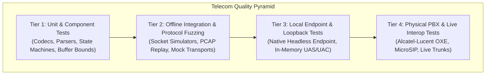
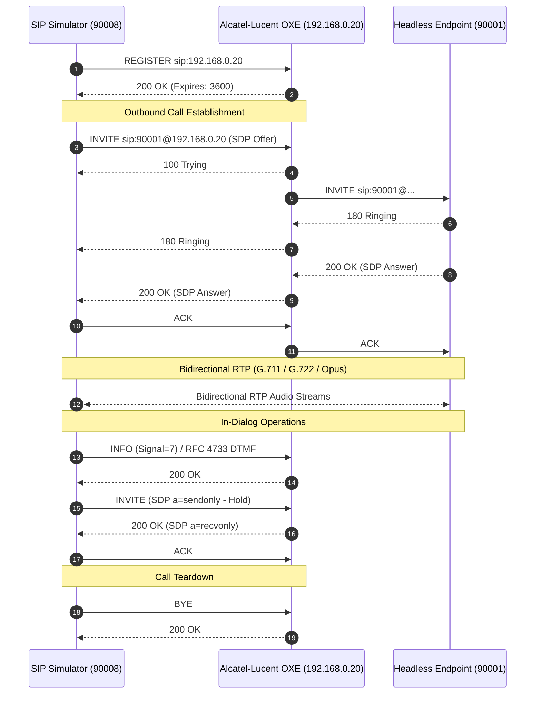
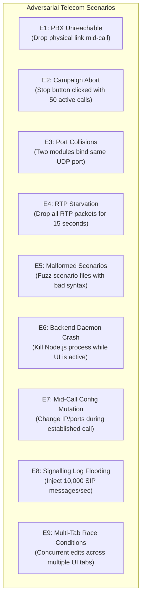

# Comprehensive QA Test Strategy & Telecom Verification Framework

**Project:** SIP Simulator v4  
**Document:** `docs/QA_TEST_STRATEGY.md`  
**Version:** 1.0.0-AUTHORITATIVE  
**Effective Date:** November 21, 2026  
**Audience:** QA Engineers, Telecom Test Specialists, Automation Engineers, System Architects  
**Repository:** `Praveen-Aj/SIP-Simulator-v4`  
**Working Branch:** `stability/feature-validation`  

---

## 1. Executive Strategy & Testing Philosophy

The SIP Simulator v4 testing strategy provides a multi-layered, rigorous quality framework for telecom software engineering. Because SIP Simulator v4 operates both as an interactive desktop workstation, a distributed multi-node load generator, a headless automation daemon, and an RFC-compliant SIP/RTP user agent, quality assurance must validate each layer independently and systematically.

> [!CRITICAL]
> **Cardinal Rule of Telecom Verification:**
> **Never treat one tier as proof of another.**
> - A passing Tier 1 Unit Test (e.g., parsing a SIP INVITE header) does **NOT** prove that a socket can handle TCP stream fragmentation (Tier 2).
> - A passing Tier 2 Offline Loopback test does **NOT** prove that SDP negotiation works against the Alcatel-Lucent OmniPCX Enterprise (OXE) PBX (Tier 4).
> - Every release candidate must pass all tiers within its designated scope.

---

## 2. Testing Levels and Methodologies

### 2.1 Level A: Unit Testing
- **Scope:** Individual classes, pure functions, algorithms, and data structures isolated from external network sockets and disk dependencies.
- **Key Focus Areas:**
  - `SIPParser` & `SIPMessage`: Header extraction (`To`, `From`, `Call-ID`, `CSeq`, `Contact`, `Via`), tag extraction, Re-INVITE vs. initial INVITE differentiation, URI decoding.
  - `Codecs` (`PcmaCodec`, `PcmuCodec`, `G722AudioCodec`, `OpusAudioCodec`): Sample-level PCM encoding and decoding, clipping prevention, zero-padding, byte ordering (endianness), clock rate handling.
  - `RtpPacket` & `RtpHeader`: Sequence number wraparound ($65535 \to 0$), timestamp incrementation by sample size, marker bit setting, payload type tagging.
  - `JitterBuffer`: Hard bounded queue size, insertion sort by sequence number, late packet drop, jitter calculation ($D(i,j) = (R_j - S_j) - (R_i - S_i)$).
  - `SipTransaction` & `SipDialog`: RFC 3261 transaction state transitions (Calling $\to$ Proceeding $\to$ Completed $\to$ Terminated).
  - `ToneSynthesizer`: Mathematical waveform generation for standard DTMF dual-frequencies, dial tone (350+440 Hz), ringback tone (440+480 Hz), and busy tone (480+620 Hz).
- **Mandatory Checks:** Boundary values (zero length, null pointers, buffer overflow limits), invalid input rejection, exception handling without JVM crash.

### 2.2 Level B: Integration Testing
- **Scope:** Interactions between interconnected subsystems, protocols, and architectural boundaries.
- **Key Focus Areas:**
  - **Java Core Engine & Node.js Backend:** Verify child process spawning, stdio/stdout streaming, REST API reverse proxying, port conflict avoidance.
  - **REST APIs & React UI:** HTTP request/response serialization, JSON payload structure, WebSocket telemetry streaming, error handling on 4xx/5xx responses.
  - **Desktop UI & Web Shared Engine:** `UnifiedSipEngineService` singleton synchronization ensuring changes in Desktop UI (e.g., registration) are reflected in Web UI and REST API.
  - **SIP Transport & Call Engine:** `SipTransportManager` routing across UDP, TCP, and TLS sockets; listener lifecycle, pre-binding socket checks.
  - **RTP & RTCP Sockets:** `RtpPortManager` allocating even port for RTP ($N$) and odd port ($N+1$) for RTCP; bidirectional transmission and receiver report parsing.
  - **Scenario Runner & File I/O:** Reading `.txt` scenarios, variable map replacement (`values.txt`), condition parsing, assertion matching, execution trace generation.

### 2.3 Level C: Functional Testing
- **Scope:** Comprehensive validation of every user-visible feature across both Desktop and Web interfaces.
- **Key Focus Areas:**
  - Positive scenarios: standard registration, outgoing call, incoming call, audio playback, call teardown.
  - Negative scenarios: wrong password (401/407), non-existent extension (404), unsupported codec (488), busy destination (486), timeout (408).
  - Boundary conditions: maximum concurrent calls, long duration calls (> 2 hours), maximum scenario file size, ultra-long SIP header values.
  - Recovery: recovery from network cable disconnection, PBX reboot, socket reset (`ECONNRESET`).

### 2.4 Level D: System and End-to-End (E2E) Testing
- **Scope:** Complete user workflows simulating real telecom test engineer journeys.
- **Workflow Steps:**
  1. Launch simulator $\to$ configure SIP account credentials $\to$ register with PBX.
  2. Select or author a test scenario $\to$ configure runtime parameters $\to$ initiate single or multi-call execution.
  3. Real-time monitoring via SIP ladder diagram, console logs, and sparkline metrics.
  4. Perform in-call operations: transmit DTMF digits, put call on hold, execute attended transfer.
  5. Call teardown $\to$ inspect RTP statistics (jitter, packet loss, MOS) $\to$ export HTML and JSON test reports.

### 2.5 Level E: Regression Testing
- **Scope:** Execution of the full automated master test suite on every code commit.
- **Requirement:** 22/22 test suites must pass cleanly without failures or flakiness (`run_offline_tests.bat`).
- **Safety Standard:** No regressions allowed in legacy SIP execution, scenario syntax, or Java 8 binary compatibility.

### 2.6 Level F: Performance, Concurrency & Reliability Testing
- **Scope:** Load capacity, sustained operation, and resource stability under stress.
- **Key Metrics:**
  - Concurrency: Sustained calls from 1 to 50+ concurrent sessions.
  - Throughput: Call generation rates up to 50 Calls Per Second (CPS).
  - Latency: SIP signaling latency ($p50, p95, p99$ response times for 100 Trying, 180 Ringing, 200 OK).
  - Resource Leaks: Heap memory stability across 1,000 sequential calls (garbage collection profiling); file descriptor and socket leak inspection (`netstat`).

### 2.7 Level G: Security Testing
- **Scope:** Protocol security, cryptographic validation, credential protection, and web surface vulnerability assessment.
- **Key Focus Areas:**
  - **SIP Digest Authentication:** RFC 2617 MD5 and SHA-256 challenge-response verification; nonce tracking, cnonce handling, realm validation.
  - **TLS Session Security:** TLS 1.2 and TLS 1.3 protocol negotiation, cipher suite validation, certificate chain verification, self-signed certificate handling in test environments.
  - **Credential Safety:** Memory wiping of SIP passwords post-digest calculation; preventing plaintext password leakage in application logs or exported reports.
  - **Input Sanitization:** Header injection prevention (CRLF injection in SIP request lines or headers); path traversal protection in scenario and log file loaders.

### 2.8 Level H: Portability & Compatibility Testing
- **Scope:** Environmental independence across platforms and deployment modes.
- **Requirements:**
  - **Java Runtime Compatibility:** Bytecode strictly targeted to Java 8 (`-source 1.8 -target 1.8`), verified to run on Java 8, 11, 17, and 21 runtimes.
  - **Operating System:** Windows 10, Windows 11, and Windows Server (x64).
  - **Display Scaling:** DPI awareness at 100%, 125%, 150%, and 200% scaling factors without control clipping (usable on $1366 \times 768$ through $3840 \times 2160$).
  - **Browsers:** Chrome, Edge, and Firefox compatibility for the Web UI.

---

## 3. Telecom Domain Verification Framework

### 3.1 Protocols and Signaling Verification Matrix

| Area | RFC / Standard | Verification Procedure | Required Evidence |
| :--- | :--- | :--- | :--- |
| **Transports** | RFC 3261 | Validate SIP exchange over UDP (5060), TCP (5060), and TLS (5061). Verify packet framing and TCP stream boundary accumulation. | Socket logs, Wireshark PCAP. |
| **Registration** | RFC 3261 §10 | Send `REGISTER`, parse `401 Unauthorized` or `200 OK`, calculate MD5 digest response (`Authorization`), handle `Expires` refresh. | SIP ladder trace, Registration state = REGISTERED. |
| **Session Initiation** | RFC 3261 §13 | Initiate `INVITE`, verify receipt of `100 Trying`, handle provisional responses (`180 Ringing`, `183 Session Progress`), verify `200 OK`, emit `ACK`. | Complete 3-way handshake log, Dialog state = CONFIRMED. |
| **Session Teardown** | RFC 3261 §15 | Issue `BYE` on confirmed dialog; issue `CANCEL` on early dialog; verify `487 Request Terminated` on cancelled INVITE. | Transaction termination trace, socket release. |
| **Session Modification** | RFC 3261 §14 | Send in-dialog Re-INVITE for Call Hold (`a=sendonly` or `c=0.0.0.0`), verify `200 OK` (`a=recvonly`), send Re-INVITE for Resume (`a=sendrecv`). | SDP attribute verification in 200 OK. |
| **SDP Offer/Answer** | RFC 4566, RFC 3264 | Validate offer/answer model, connection line `c=IN IP4 <ip>`, media line `m=audio <port> RTP/AVP <codecs>`, rtpmap and fmtp attributes. | Formatted SDP payload inspection. |
| **Codec Negotiation** | RFC 3551, RFC 7587 | Test PCMA (PT 8), PCMU (PT 0), G.722 (PT 9, 8 kHz clock rate), Opus (PT 111, 48 kHz clock rate, stereo=2 SDP syntax). | Media codec negotiation log, negotiated PT. |
| **RTP Media** | RFC 3550 | Validate 20ms packetization interval (160 samples for G.711/G.722, 960 samples for Opus), SSRC generation, timestamp increments. | RTP packet sequence, packet inter-arrival jitter. |
| **RTCP Reports** | RFC 3550 §6 | Verify transmission and reception of RTCP Sender Reports (SR) and Receiver Reports (RR) on port $N+1$, fraction lost, cumulative packet loss. | RTCP packet hex dump, parsed jitter and loss. |
| **DTMF Signaling** | RFC 4733, RFC 2976 | Dual verification: 1) In-band RTP Named Telephony Events (PT 101, volume, end bit), 2) Out-of-band SIP `INFO` (`Signal=X`, `Duration=160`). | RFC 4733 packet trace, SIP INFO 200 OK log. |
| **Call Transfer** | RFC 3515, RFC 3892 | 1) Blind Transfer: `REFER` with `Refer-To: <target>`. 2) Attended Transfer: `REFER` with `Refer-To: <target>?Replaces=<Call-ID>`. Process `NOTIFY`. | REFER/NOTIFY ladder trace, target connection. |
| **Telecom Headers** | RFC 3325, 3326, 4244 | Injection and extraction of `P-Asserted-Identity`, `Privacy`, `Diversion`, `History-Info`, and `User-to-User` (UUI) headers. | Raw SIP header dump showing parsed tokens. |
| **OXE PBX Interop** | Alcatel OXE R101 | Interoperability testing against physical Alcatel-Lucent OmniPCX Enterprise at `192.168.0.20`: extensions `90008` (simulator) and `90001` (endpoint). | Live OXE ladder logs, zero 488/500 errors. |

---

## 4. Exploratory Testing Methodology & Telecom Failure Injection

The QA Agent must act as an aggressive, adversarial tester exploring system failure modes. The following failure injection scenarios must be executed and validated:

### 4.1 Exploratory Test Procedures

#### E1: PBX Unreachable During Established Call
- **Action:** Initiate call $\to$ establish 2-way audio $\to$ pull network cable or block PBX IP via firewall.
- **Expected System Behavior:** Core engine detect missing RTP/RTCP after timeout; SIP transaction timer B/F fire (32 seconds); session gracefully transition to `FAILED` or `TERMINATED`; all allocated UDP sockets freed cleanly.
- **Defect Symptoms:** Hanging UI, unkillable threads, permanently orphaned RTP sockets.

#### E2: Abrupt Campaign Cancellation with In-Flight Calls
- **Action:** Launch test campaign with 50 concurrent calls $\to$ click "STOP" abruptly when 25 calls are ringing and 25 are established.
- **Expected System Behavior:** Immediate transmission of `CANCEL` for early calls and `BYE` for established calls; active thread pool drained; campaign summary correctly records terminated count without hanging.
- **Defect Symptoms:** Orphaned ringing calls remaining on PBX, UI freeze, JVM thread exhaustion.

#### E3: SIP & RTP Port Collisions
- **Action:** Configure SIP Simulator to listen on UDP 5060 while another application (e.g., MicroSIP) is already bound to 5060; or attempt to bind duplicate RTP ports.
- **Expected System Behavior:** `SipTransportManager` and `RtpPortManager` catch `BindException` pre-flight; display an informative error dialog to user; gracefully fall back to alternative port or fail cleanly without crashing.
- **Defect Symptoms:** Silent failure, uncaught exception stack traces printed to stderr, corrupt socket state.

#### E4: Media Packet Starvation
- **Action:** Establish call $\to$ simulate complete network packet loss on RTP stream while SIP signaling remains alive.
- **Expected System Behavior:** Jitter buffer log packet starvation; MOS score degrade to 1.0; RTCP Receiver Reports indicate 100% loss; call remain signaling-active until user or PBX terminates.
- **Defect Symptoms:** JVM OutOfMemoryError, infinite loop in jitter buffer, audio subsystem lockup.

#### E5: Malformed Scenario Syntax Fuzzing
- **Action:** Load scenario file with missing headers, unclosed brackets, invalid regex conditions, negative delay values, and non-ASCII binary garbage.
- **Expected System Behavior:** Scenario parser reject file with descriptive line-number error; UI display validation warning; editor remain fully operational.
- **Defect Symptoms:** Application crash, unhandled `NullPointerException`, file corruption.

#### E6: Node.js Backend Crash with Active React UI
- **Action:** Open Web UI $\to$ kill `node.exe` process via task manager.
- **Expected System Behavior:** React UI display persistent "Backend Disconnected / Reconnecting..." banner; retry polling with exponential backoff; automatically restore state once backend restarts.
- **Defect Symptoms:** White screen of death (uncaught React runtime error), broken controls, silent data desynchronization.

#### E7: Configuration Mutation During Active Operation
- **Action:** Navigate to Settings while a load campaign is running $\to$ modify local IP address, SIP port, or transport type.
- **Expected System Behavior:** Settings fields either disabled (read-only) during active campaigns, or changes staged for "Apply on Next Restart" with clear warning.
- **Defect Symptoms:** Mid-flight socket re-binding, active call disconnects, corrupt configuration files.

#### E8: Signalling Log Flooding & UI Rendering Stress
- **Action:** Stream 10,000 SIP messages in rapid succession into `SipMessageExplorerTab` and Web Console.
- **Expected System Behavior:** UI virtualized list / circular buffer hold fixed maximum rows (e.g., 1,000 entries); Swing Event Dispatch Thread (EDT) remain responsive ($>30$ FPS); memory heap remain bounded.
- **Defect Symptoms:** UI freeze ("Not Responding"), severe memory bloat, GC pause spikes.

#### E9: Multi-Tab Concurrent Operations
- **Action:** In Web UI, open Scenario Editor in Tab 1, launch Campaign in Tab 2, and use Live Phone in Tab 3 concurrently.
- **Expected System Behavior:** Backend handle concurrent REST requests without state corruption; campaign telemetry accurately isolate its own Call-IDs from Live Phone Call-IDs.
- **Defect Symptoms:** Call-ID crosstalk, campaign statistics contaminated by manual calls, session state collision.
